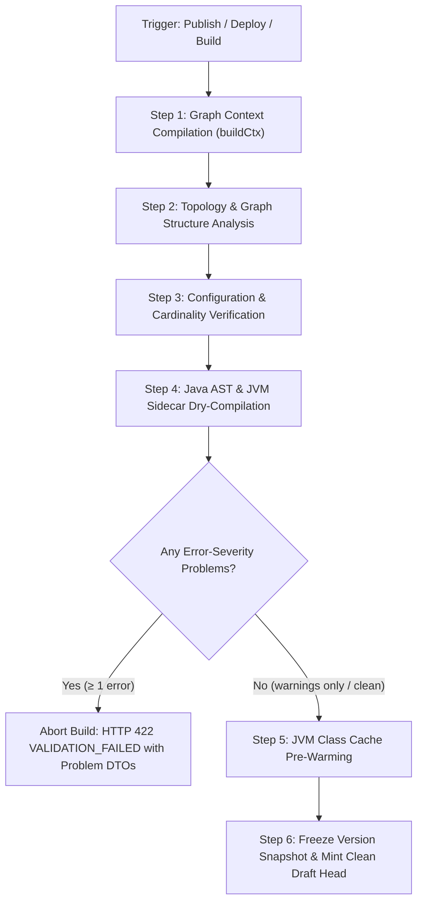

# 12 — Build Stage Pipeline & Validation Rules

The engine-native equivalent of jBPM/Business Central BPMN diagram validation, KJAR Maven build verification, and Java syntax dry-compilation, adapted to the high-performance Node engine and JVM sidecar runtime.

Implemented as an authoritative validation suite on both ends:
- **Backend (Authoritative Gate)**: `server/src/modules/validation/` — `rules.ts` (graph builder + 21 engine rules) and `service.ts` (`assertValid`). Runs synchronously and asynchronously over each `EngineProcess`.
- **UI (Live Feedback)**: `app/src/app/features/builder/problems-panel.component.ts` + live debounced `POST /api/validate`; displays interactive problem markers on canvas nodes, highlights sequence flows, and gates the **Deploy Project** action while blocking errors exist.

---

## 1. What Happens in the Build Stage

When a project or process is **Built**, **Published**, or **Deployed**, the engine executes a deterministic 6-step build pipeline:



### Detailed Pipeline Breakdown

1. **Graph Context Compilation (`buildCtx`)**:
   - The engine parses `process.nodes` and `process.flows`.
   - Compiles node identity maps (`byId`), forward edge maps (`outgoing`), backward edge maps (`incoming`), and attaches boundary handlers (`boundaryByHost`).
   - Identifies start nodes, end nodes, and event-subprocesses.
   - Computes forward-reachability sets starting from Start nodes, event sub-processes, and process-global error catches (`*`).

2. **Topology & Structural Integrity Analysis**:
   - Executes structural rules: verifies graph connectedness, ensures no orphaned or floating nodes exist, and checks that every sequence flow connects valid source and target nodes.
   - Verifies loop terminations: performs reverse-reachability traversal from all End nodes back through incoming flows to guarantee that no execution path dead-ends or spins in an un-terminable infinite loop.

3. **Node Configuration & Cardinality Verification**:
   - Deeply inspects node properties based on each node's `NODE_DEF_BY_TYPE` port definitions:
     - Enforces max input and max output limits (e.g., tasks are strictly 1-in/1-out; gateways fan-out 1→many or fan-in many→1).
     - Validates mandatory fields: script tasks have non-empty code; HTTP service tasks have target URLs; rule tasks declare ruleflow groups or DMN files; call activities specify called processes.
     - Validates throw and catch events to ensure authors have not left signal, error, message, or escalation names blank (preventing silent runtime no-ops).

4. **Java AST & JVM Sidecar Dry-Compilation (`java-support`)**:
   - Recursively walks all nodes, sequence flows, embedded sub-processes, and event sub-processes.
   - **Layer 1 (Static Denylist via `java-compat.ts`)**: Fast in-memory AST and regex scan that prohibits unsafe JVM operations (`System.exit`, reflection `java.lang.reflect`, thread spawning, socket connections, unauthorized filesystem access).
   - **Layer 2 (Dynamic `javac` Dry-Compilation via `java-sidecar.ts`)**: Forwards the exact script text, `onEntry`/`onExit` actions, HTTP `exitScript`, and sequence flow conditions (`when`) to the persistent JVM sidecar process.
   - Compiles the code against the Java runtime wrapper using the exact declared process variable types (`varTypes`). If compilation fails, the exact line-numbered Java compiler error is reported as a blocking validation error.

5. **JVM Class Cache Pre-Warming**:
   - Because the build-stage dry-compile uses the exact variable types and wrapper shape as live execution (`ScriptRunner.classNameFor`), the compiled Java bytecode is retained in the JVM sidecar's memory cache.
   - At runtime, the first execution of that script task or condition hits the warm cache, eliminating cold-start JIT compilation latency.

6. **Version Snapshot & Draft Advancement**:
   - Upon successful validation, `VersionService.publish()` freezes the current draft (`state: 'published'`), attaches the version label (e.g., `v1.0.0`), and records an immutable snapshot.
   - A fresh draft is opened as the new branch head, allowing authors to continue iterative development without mutating the published artifact.

---

## 2. Enforcement Gates: Errors vs. Warnings

| Action | Errors Exist | Warnings Exist | Clean (0 Problems) |
|---|---|---|---|
| **Draft Autosave** | Allowed (Work-in-progress preserved) | Allowed | Allowed |
| **Publish Version** | **Blocked** (`422 VALIDATION_FAILED`) | Allowed (surfaced in audit log) | Allowed |
| **Deploy Project** | **Blocked** (`422 VALIDATION_FAILED`) | Allowed (flagged in release notes) | Allowed |
| **Instance Execution**| **Blocked** (Engine refuses unvalidated deployment) | Allowed | Executed |

---

## 3. Complete Build Validation Rules Matrix

| Rule ID | Severity | BPMN / jBPM Equivalent | Triggers When | Runtime Failure Mode Prevented |
|---|---|---|---|---|
| `start-exists` | **Error** | "Process has no start node" | Graph has 0 start nodes | Process cannot be instantiated by engine or API |
| `end-exists` | **Error** | "Process has no end node" | Graph has 0 end nodes | Tokens can never complete; instances hang indefinitely |
| `single-start` | **Warning** | "Multiple start events" | Graph has > 1 start nodes | Unintended duplicate instance triggers on ambiguous starts |
| `unique-ids` | **Error** | "Duplicate node id" | Multiple nodes share identical `id` | Token routing collisions; state corruption in execution engine |
| `flow-endpoints` | **Error** / Warning | "Dangling sequence flow" | Flow `from` or `to` points to non-existent node ID; self-loop | Engine crashes on token propagation; circular infinite loops |
| `flow-direction` | **Error** | "Invalid sequence flow direction" | Connection connects to port with `maxIn: 0` or leaves `maxOut: 0` | Flow connects backwards into a Start event or out of an End event |
| `connection-cardinality` | **Error** | "Too many connections / mixed gateway" | Node exceeds `maxIn` / `maxOut` (e.g. task has >1 in or out; gateway both diverges and converges) | Split token confusion, incomplete joins, missing gateway synchronization |
| `start-connections` | **Error** | "Start connection error" | Start node has incoming connections or 0 outgoing connections | Invalid process entry; token traps at process start |
| `end-connections` | **Error** | "End connection error" | End node has 0 incoming connections or has outgoing connections | Tokens attempt to transition beyond process completion |
| `unsupported-construct` | **Warning** | "Unsupported BPMN construct" | Node type is unmodeled in engine and imported as opaque 'raw' | Sub-process or task logic skipped silently at runtime |
| `node-connected` | **Error** | "Node is not connected" | Activity, gateway, or event has 0 in or 0 out (floating node) | Unreachable logic; token deadlock on broken flow paths |
| `reachable` | **Error** | "Unreachable node" | Node is not reachable from any Start event or event-subprocess | Dead code; orphaned logic running outside process lifecycle |
| `ends-at-end` | **Error** | "Dead-end / infinite loop" | Reachable node cannot reach any End event via forward flows | Instances hang forever; tokens trapped in dead ends or loops |
| `boundary-host` | **Error** | "Boundary not attached" | Boundary event references non-existent node ID or missing `on` | Errors or timer events lost; failure to catch exceptions |
| `node-config` | **Error** | "Task/Gateway missing config" | Script has no code; HTTP has no URL; Call has no process; Rule has no DMN/DRL; Throw/Catch has blank name | Silent runtime no-ops; null pointer exceptions during task execution |
| `event-trigger` | **Error** | "Event with no trigger" | Catch/throw/boundary lacks trigger definition; timer has no cycle/duration/date | Token waits forever; timer job cannot be computed or scheduled |
| `gateway-branching` | **Warning** | "Gateway non-deterministic" | Exclusive/inclusive gateway has multiple unconditional branches | Unpredictable path selection under race conditions |
| `usertask-assignment` | **Warning** | "Unassigned human task" | User task has neither candidate group nor assignee | Task lands in orphan queue; no user is notified to act |
| `condition-lang` | **Warning** | "Unsupported condition dialect" | Sequence flow condition uses dialect other than `js` or `java` | Condition defaults to false or causes runtime evaluation error |
| `node-name` | **Warning** | "Unnamed activity" | Task, activity, or sub-process has empty name | Poor audit trail readability; confusing task inbox display |
| `java-support` | **Error** | "Java compiler error / Security violation" | Script, `onEntry`, `onExit`, or flow condition fails denylist or sidecar `javac` compile | Instance crashes with fatal Java evaluation error at runtime |

---

## 4. Java Validation & Compilation Deep-Dive

Java is a first-class execution dialect within this engine. To achieve 100% parity with jBPM while maintaining strict operational safety and zero-compile latency, the `java-support` rule executes a dual-layer check:

### 4.1. Static Denylist Analysis (`java-compat.ts`)
Before invoking the JVM sidecar, scripts are scanned for restricted APIs. If any forbidden construct is detected, build validation immediately halts:
- **Process & Environment**: `System.exit`, `Runtime.getRuntime()`, `ProcessBuilder`
- **Reflection**: `java.lang.reflect.*`, `Method.invoke`, class loader modifications
- **Threading**: `Thread.start()`, `ExecutorService`, custom background threads
- **Networking & I/O**: Direct socket creation, arbitrary file writes (must use engine-managed HTTP tasks)

### 4.2. JVM Sidecar Dry-Compilation (`java-sidecar.ts`)
Any script that passes the static denylist is compiled against the live Java compiler in the JVM sidecar:
- **Scope Synthesis**: The build engine synthesizes a typed wrapper mimicking `kcontext` and all declared process variables (`varTypes` dictionary, e.g. `{ claimAmount: 'Double', isApproved: 'Boolean' }`).
- **HTTP Exit Scripts**: HTTP service tasks with Java `exitScript` are supplied with synthesized `resPayload: 'String'` bindings.
- **Recursive Sub-Process Scanning**: Embedded sub-processes and event sub-processes are recursively traversed to guarantee that nested Java scripts compile cleanly.
- **Bytecode Cache Warm-up**: The JVM compiler stores the compiled class bytecode in its class cache keyed by `(scriptHash, varTypesShape)`. When the deployed process runs in production, the engine skips compilation entirely.

---

## 5. API Response Schema on Validation Failure

When a build, publish, or deploy action fails validation, the server returns an HTTP 422 with a structured error payload:

```json
{
  "error": "VALIDATION_FAILED",
  "message": "Cannot publish: process has 2 errors",
  "problems": [
    {
      "rule": "ends-at-end",
      "severity": "error",
      "message": "\"Review Assessment\" does not lead to an end event — every process path must finish at an End",
      "nodeId": "node-17482"
    },
    {
      "rule": "java-support",
      "severity": "error",
      "message": "Script \"Format Claim Payload\": cannot find symbol: variable invalidField",
      "nodeId": "node-99312"
    }
  ]
}
```

This structured response allows the UI Problems panel to immediately navigate the user's canvas view directly to the offending node (`nodeId`) or sequence flow (`flowId`).
