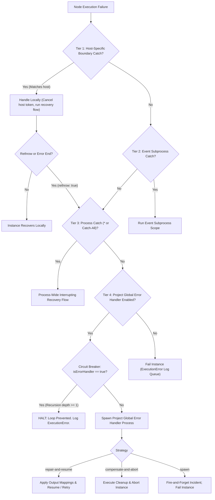
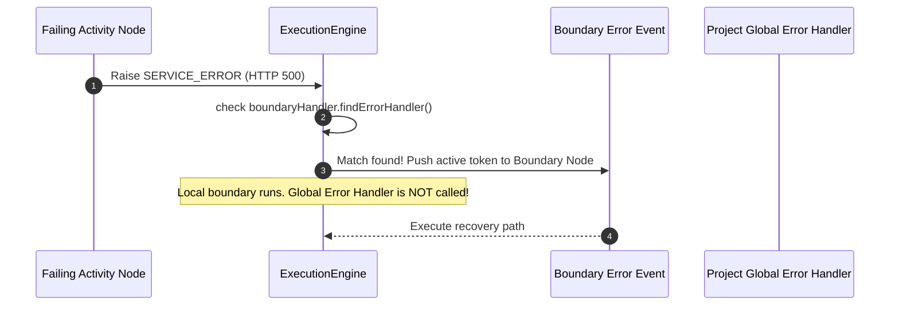
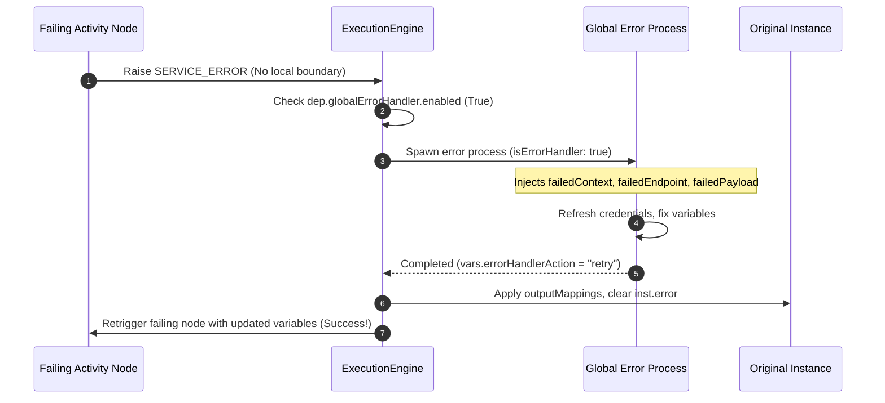
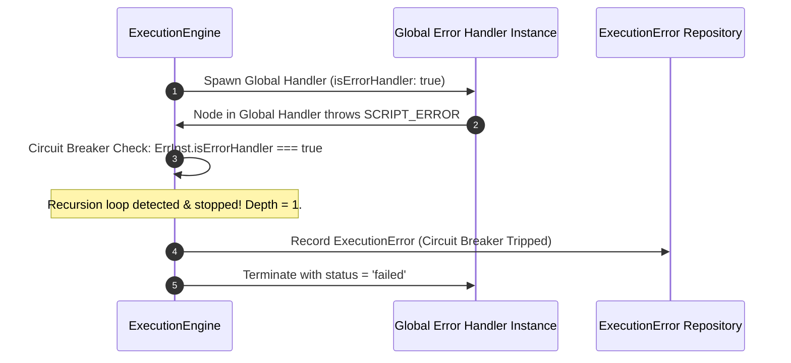

# 14 — Error Handling (Error Catch / Boundary / Global)

Two jBPM error-handling shapes are both first-class here: a **boundary error event** (`type:
'boundary'`) attached to specific activities, and jBPM's *other* native idiom, an **event
sub-process with an error start event** (`type: 'subprocess'` with `on.error`) — the process-wide
handler shape a mechanically-converted real jBPM project (this project's own sample included) is
actually built from. Both route through the same matching/routing logic below; an event
sub-process catch is always process-wide (there's no host list to select — see §1).

## 1. Model (engine JSON)

An error catch is a `boundary` node:
```jsonc
{
  "type": "boundary",
  "on": ["taskA", "taskB"],   // node id(s) to catch from; ["*"] = ALL nodes (process-wide handler)
  "event": { "error": "*" },  // error code to match; "*" or "" = any error
  "interrupting": true         // cancel the caught activity (error boundaries are interrupting)
}
```
- `on` — a single id, a **list of ids** (boundary on each), or `["*"]` (global/process-wide).
- `event.error` — jBPM's declared error name/id (e.g. `"REST_API_FAILURE"`, matching what a real
  BPMN project's `errorRef` says) — see §2 for how this maps to a runtime code; it does **not**
  need to be one of the built-in codes below.
- The node's **outgoing flow is the recovery path** — connect it to the nodes that handle the error.
- When caught, the variable **`errorInfo` = `{ code, node, message }`** is set for the recovery path.

An **event sub-process** catch is the same idea with a different shape: `{ "type": "subprocess",
"on": { "error": "<declared name>" }, "nodes": [...], "flows": [...] }` — no host list (always
process-wide/interrupting), and its `nodes`/`flows` run as a nested child instance when triggered
(the same mechanism a normal sub-process invocation uses), starting from whichever node inside it
is `type: 'start'`.

**Selecting all nodes ⇒ a global error handler for the process.** Selecting specific nodes ⇒ per-node
boundary catches. One node concept, both behaviors — configured in the Properties panel with a node
checklist + an “All nodes (process-wide)” toggle.

## 2. Error taxonomy (what can be caught) — and why a catch's *name* doesn't need to match it

| Code | Raised when |
|------|-------------|
| `SCRIPT_ERROR` | a Script task throws |
| `SERVICE_ERROR` | a Service (REST) task fails — non-2xx / network / timeout |
| `RULE_ERROR` | a Business Rule / DMN evaluation fails |
| `CALL_ERROR` | a called sub-process errors or isn't deployed |
| `RUNTIME_ERROR` | any other handler exception |
| *custom* | an **error-throw End** (`end.throw.error = "MY_CODE"`) raises exactly that literal code |

These five are the only codes a node *execution failure* can ever actually raise, and which one is
possible is fully determined by the failing node's type — an `http` node can only ever produce
`SERVICE_ERROR`, never `SCRIPT_ERROR`. jBPM error declarations, by contrast, are named for human/XML
readability (`REST_API_FAILURE` with `errorCode`
`org.jbpm.bpmn2.handler.WorkItemHandlerRuntimeException`) — a mechanically-converted real jBPM
project's `event.error`/`on.error` is almost never one of the five codes above verbatim. So matching
works differently depending on scope:
- **Host-specific** (`on` is a real node id or id list, not `["*"]`): matches **any** error from that
  host, regardless of the catch's declared name — since a single host can only ever raise one
  category of failure anyway, the name was never load-bearing there. `REST_API_FAILURE`,
  `HR_SERVICE_FAILURE`, anything — all work without the author needing to know this runtime's
  internal vocabulary.
- **Global** (`on: ["*"]`, or any event sub-process catch, which is always global): an **exact**
  name match wins first (so an author-thrown custom error, e.g. `end.throw.error = "VALIDATION"`
  paired with a catch named `"VALIDATION"`, matches precisely). Failing that, if the raised code
  actually came from a node execution failure (i.e. is one of the five above) and the catch's name
  is *not* itself one of the five, the catch is treated as meaning `SERVICE_ERROR` — the dominant
  real-world "global error handler" case (this project's own `pru-sample-global-error` /
  `pru-api-error-handler` are exactly that pattern). A catch named `""`/`"*"`/`"ANY"` is a true
  catch-all regardless.

## 3. Runtime behavior: The 4-Tier Hierarchical Error Architecture

When a node raises an error, the engine resolves it through a multi-tiered precedence hierarchy:



### Precedence Resolution Steps:
1. **Tier 1 (Host-specific)**: Attached directly to the failing node (`boundaryHandler.findErrorHandler`). If found and `rethrow !== true`, runs locally; the Global Error Handler is **not** invoked.
2. **Tier 2 (Scope Event Subprocess)**: If failing node is inside a subprocess with an error start event.
3. **Tier 3 (Process-wide Catch)**: Boundary with `on: '*'` or root event subprocess.
4. **Tier 4 (Project Global Error Handler)**: Configured in Project Settings (`Workflow.globalErrorHandler` & `Deployment.globalErrorHandler`).
   - Circuit Breaker strictly checks `if (inst.isErrorHandler) return false;` (recursion depth capped at 1).
   - Injects rich context (`errorInfo`, `errorContext`, `failedContext`, `failedEndpoint`, `failedPayload`, etc.).
   - Executes strategy:
     - `repair-and-resume`: Applies `outputMappings` back to original instance variables. Resumes after failing node, or retries the node if `errorHandlerAction === 'retry'`.
     - `compensate-and-abort`: Executes cleanup, transitions original instance to `aborted`.
     - `spawn`: Runs background incident flow, marks original instance `failed`.

## 4. Sequence Diagrams

### Sequence A: Local Boundary Precedence


### Sequence B: Project Global Error Handler (Repair & Resume / Retry)


### Sequence C: Circuit Breaker Loop Prevention


## 5. Validation (Phase 7 rules)

- `boundary-host` — an error catch must attach to existing node(s) or `*`; else error.
- `node-connected` — the catch must have an outgoing (recovery) connection.
- `reachable` — node-attached catches are reachable via their host; global (`*`) catches are always
  reachable. So an error catch with no recovery path or a dangling attach blocks publish.

## 5. Export to jBPM (capability)

`fromEngine` expands an error catch to standard BPMN on export:
- **single host** → one boundary error event on that activity (as today).
- **multiple hosts** → **one boundary event per host**, each sharing the catch's recovery flow.
- **global (`*`)** → a boundary event on **every activity** except the catch's own recovery path
  (a valid BPMN approximation of a process-wide handler). *Follow-up:* emit a true **event
  sub-process with an error start event** for the global case (cleaner kjar); tracked in the checklist.

Error codes become BPMN `<error errorCode=…>` declarations and `errorRef`s; `*`/blank ⇒ a catch-all
boundary (no errorRef). Verified by `bpmn-sdk/test/engine-error-catch.test.mjs`.

## 6. UI

Palette: **Error Catch** (red ⚠). Properties → *Catch from*: a checklist of the process's nodes plus
**All nodes (process-wide handler)**; *Trigger*: error with a code field (blank/`*` = any, with
built-in code suggestions); *Interrupting*. Draw the catch's outgoing flow to the recovery nodes.
Multiple error catches per process are allowed (different nodes / codes).
