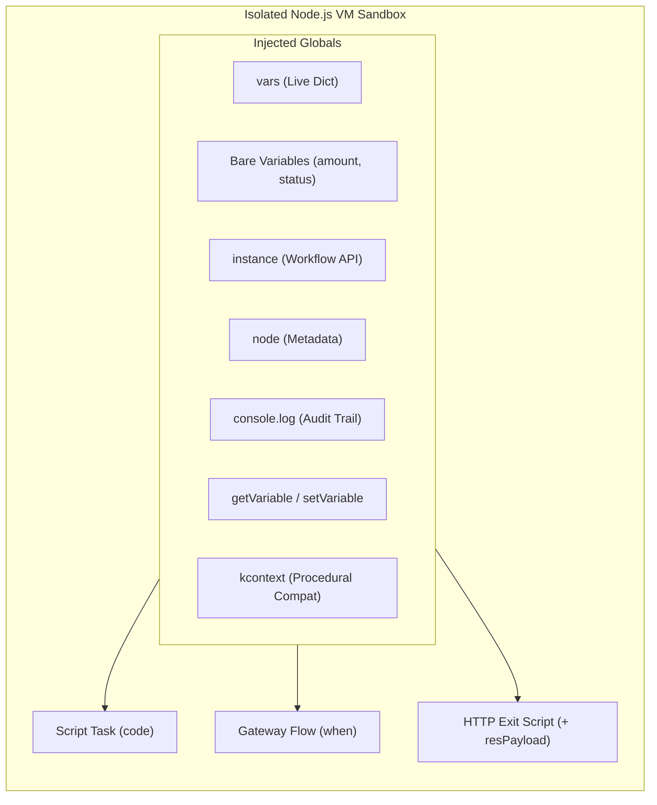
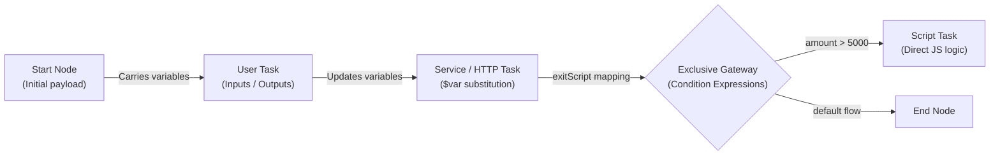

# JavaScript & Flow Variables Cheat Sheet

A comprehensive, all-in-one reference for writing JavaScript scripts, conditions, data mappings, and manipulating flow variables across the Workflow Engine.

---

## 1. Quick Reference: Where Can You Write JavaScript?

| Location | Purpose | Available Globals & Execution Context |
|---|---|---|
| **Script Task** (`script`) | Synchronous business logic, data calculations, payload transformations | `amount` (bare vars), `vars`, `getVariable()`, `setVariable()`, `instance`, `node`, `console`, `env`, `kcontext` |
| **Gateway Sequence Flow** (`gateway` / branch) | Boolean condition deciding which path the token takes | `amount` (bare vars), `vars`, `getVariable()`, `instance`, `node`, `env`, `kcontext` *(Must return boolean)* |
| **HTTP Service Task Exit Script** (`service` / `exitScript`) | Post-process or normalize HTTP response | All Script Task globals **+ `resPayload`** (raw HTTP response text) |
| **Data Mappings** (`userTask`, `call`, `forEach`) | Map flow variables into tasks and map results back | Variable names, property paths (`$varName`), input/output contracts |



---

## 2. Process Variables: 3 Ways to Read & Write

All three styles interact with the **exact same underlying data store**. You can use whichever style you prefer.

### Style 1: Modern Bare Variables (Recommended)
You do NOT need any prefixes or getters. Declared flow variables are available directly as global identifiers:

```javascript
// 1. Reading a bare variable:
if (amount > 1000) {
  // 2. Writing a bare variable (assign directly without 'var', 'let', or 'const'):
  status = "NEEDS_APPROVAL";
  discount = amount * 0.15;
}

// 3. Scratch / local variables (use 'const' or 'let' so they stay private to this node):
const factor = 1.05;
const tempSum = amount * factor;
```

> [!TIP]
> **Variable Assignment Rule**:
> - Assigning without a keyword (`status = "APPROVED"`) persists the value back to the process instance variables.
> - Declaring with `const` or `let` keeps the variable local to the script, preventing unwanted variable pollution.

---

### Style 2: The `vars` Object (Recommended for Nested JSON)
The `vars` object is the live dictionary of all process variables. It is ideal for deep property access, dynamic keys, or structured JSON data:

```javascript
// Reading nested properties:
const claimantName = vars.claim.claimant.fullName;

// Mutating nested properties:
vars.claim.payout = 4500;
vars.claim.adjudicatedAt = new Date().toISOString();

// Dynamic or special keys:
vars["custom-header-key"] = "Value-123";
```

---

### Style 3: Top-Level `getVariable()` & `setVariable()`
Clean functional helpers available at global scope:

```javascript
const tier = getVariable("riskTier");
setVariable("approvalLevel", tier === "HIGH" ? 3 : 1);
```

---

### Style 4: Procedural Compatibility (`kcontext`)
Maintained for workflows migrated from procedural engines:

```javascript
var amt = kcontext.getVariable("claimAmount");
kcontext.setVariable("payout", amt - 100);
```

---

## 3. Workflow Engine Instance API (`instance`)

Every script and condition has access to the `instance` object representing the live running process instance:

| Property / Method | Return Type | Description | Example |
|---|---|---|---|
| `instance.id` | `string` | Unique UUID of the running process instance | `console.log(instance.id)` |
| `instance.processId` | `string` | Process definition ID | `"claims-adjudication"` |
| `instance.processName` | `string` | Human-readable process display name | `"Medical Claims Adjudication"` |
| `instance.correlationKey` | `string` | Business correlation key (e.g., Policy #, Order ID) | `"POL-98421"` |
| `instance.parentId` | `string \| undefined` | Parent instance UUID if running in Subprocess / Call Activity | `instance.parentId` |
| `instance.state` | `string` | Current instance status (`running`, `waiting`, `completed`, `aborted`) | `if (instance.state === 'running')` |
| `instance.variables` | `object` | Direct reference to the process variables map | `instance.variables.amount` |
| `instance.activeNodes` | `Array<{id, nodeId, name}>` | Active tokens and nodes currently being executed | `instance.activeNodes.map(n => n.name)` |
| `instance.signal(type, payload)` | `void` | Signals **THIS** specific instance (resumes waiting catch event) | `instance.signal("DocUploaded", { docId: 123 })` |
| `instance.signalOther(targetId, type, payload)` | `void` | Delivers a signal to a specific other process instance | `instance.signalOther(partnerId, "Notify")` |
| `instance.broadcast(type, payload)` | `void` | Broadcasts a signal to **all** active instances listening for this event | `instance.broadcast("SystemMaintenance")` |
| `instance.abort()` | `void` | Terminates and aborts **THIS** process instance immediately | `instance.abort()` |
| `instance.abortOther(targetId)` | `void` | Terminates and aborts another process instance by ID | `instance.abortOther(childId)` |

### Practical Instance API Examples:

```javascript
// Resume a waiting Intermediate Catch Event in this same instance:
instance.signal("PAYMENT_RECEIVED", { amount: 1500, txRef: "TX-9901" });

// Broadcast a system-wide cancellation to all active workflows:
instance.broadcast("EMERGENCY_SHUTDOWN", { reason: "Maintenance" });

// Abort workflow if invalid policy data is discovered:
if (!vars.policy || !vars.policy.isActive) {
  console.log(`Aborting invalid claim for correlation key ${instance.correlationKey}`);
  instance.abort();
}
```

---

## 4. Node Metadata (`node`)

Information about the currently executing node:

| Property | Type | Description | Example |
|---|---|---|---|
| `node.id` | `string` | Active execution token ID | `"tok_39102"` |
| `node.nodeId` | `string` | Node definition ID configured in the canvas | `"script_validate_order"` |
| `node.name` | `string` | Display label of the node | `"Validate Order Payload"` |

```javascript
console.log(`Executing step "${node.name}" [ID: ${node.nodeId}] on token ${node.id}`);
```

---

## 5. System Logger & Audit Trail (`console.log`)

Any output written to `console.log(...)` is captured in real-time and permanently appended to the Process Instance Execution Audit Log:

```javascript
console.log(`Processing claim ${instance.correlationKey} with amount ${amount}`);
console.log("Calculated tax breakdown:", JSON.stringify({ base: amount, tax: amount * 0.18 }));
```

---

## 6. Gateway Sequence Flow Condition Syntax

Sequence flows exiting **Exclusive (XOR)** or **Inclusive (OR)** Gateways evaluate a boolean condition expression.

### Syntax Rules:
1. Must evaluate to a truthy or falsy boolean value (`true` / `false`).
2. Can be a single expression or a full multi-line block ending with `return <boolean>;`.
3. If no `return` keyword is used, the engine wraps the expression automatically (e.g., `amount > 5000` becomes `return (amount > 5000);`).

### Common Gateway Condition Recipes:

```javascript
// 1. Numeric Comparison
amount > 5000

// 2. Compound Boolean Logic
riskTier === "HIGH" && creditScore < 650

// 3. Nested Object Property Check
vars.claim.payout > 10000 || vars.policy.isVIP === true

// 4. String Pattern Matching
customerType.startsWith("CORP_") || email.endsWith("@prudential.com")

// 5. Array Membership Check
tags.includes("HIGH_RISK") || roles.some(r => r === "SUPERVISOR")

// 6. Safe Null / Undefined Navigation
vars.customer?.kyc?.verified === true

// 7. Multi-Line Condition Block
const netAmount = requestedAmount - deductible;
return netAmount > 25000 && riskRating !== "LOW";
```

---

## 7. Service / HTTP Task Exit Scripts (`exitScript`)

When an HTTP Service Task executes, its `exitScript` runs immediately after the response arrives.

### Special Exit Script Variables:
- `resPayload`: The raw HTTP response body as a string.
- `vars[resultTo]`: The parsed JSON response object (if `resultTo` variable was configured).

```javascript
// Example: Process raw response text
const response = JSON.parse(resPayload);

if (response.status === "APPROVED") {
  claimStatus = "SETTLED";
  paymentId = response.transactionId;
  vars.settlementDate = new Date().toISOString();
} else {
  claimStatus = "REJECTED";
  rejectionReason = response.errorDescription || "External API verification failed";
}
```

---

## 8. Process Data Mappings (Data Flow Between Nodes)

Flow variables are carried by the process instance throughout its entire lifecycle.



### A. User Task Mappings:
- **Inputs**: Map process variables into task form fields:
  ```json
  { "claimNumber": "caseId", "claimantName": "vars.customer.name", "amount": "amount" }
  ```
- **Outputs**: Map form submission values back into process variables upon task completion:
  ```json
  { "reviewDecision": "status", "managerNotes": "approvalRemarks" }
  ```

### B. Service (HTTP) Task String Interpolation:
In the URL, headers, or body, prefix variable names with `$` to interpolate:
- **URL**: `https://api.internal/claims/$caseId/payout`
- **Headers**: `{ "X-Correlation-ID": "$correlationKey", "Authorization": "Bearer $token" }`
- **Request Body**: `{ "amount": $amount, "policyNumber": "$policyNumber" }`
- **Result Variable (`resultTo`)**: Stores the parsed JSON response into a process variable name (e.g. `apiResult`).

### C. Subprocess & Call Activity Mappings:
- **`inputMappings`**: `{ "childCaseId": "caseId", "childAmount": "amount" }` — copies variables from parent to child upon spawning.
- **`outputMappings`**: `{ "parentStatus": "childStatus" }` — copies variables from child back to parent upon child completion.

---

## 9. Common Script Snippets & Patterns

### A. Array Processing & Aggregations
```javascript
// Calculate total claim items:
const items = vars.claim.items || [];
const total = items.reduce((sum, item) => sum + (item.cost * item.quantity), 0);
vars.claim.calculatedTotal = total;
amount = total;
```

### B. Date & Timestamp Calculations
```javascript
// Calculate SLA deadline (e.g. 3 business days from now):
const due = new Date();
due.setDate(due.getDate() + 3);
vars.taskDueDate = due.toISOString();
```

### C. Safe Object Merging
```javascript
// Merge incoming payload into existing data:
vars.claim = {
  ...vars.claim,
  reviewedBy: "Adjudicator_12",
  reviewDate: new Date().toISOString(),
  decision: "APPROVED"
};
```
