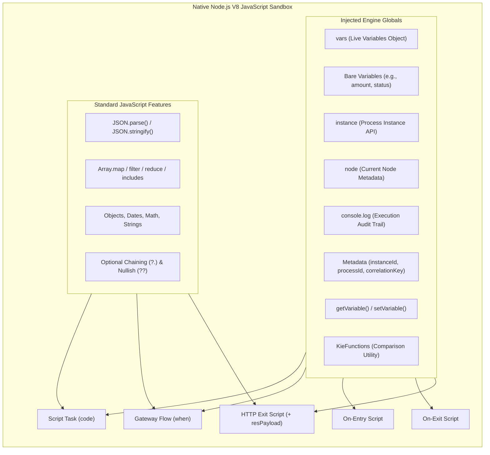
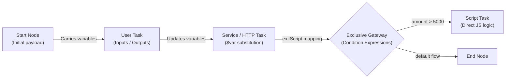

# JavaScript & Flow Variables Master Cheat Sheet

A comprehensive, developer-first reference for writing modern **JavaScript** scripts, gateway conditions, data mappings, and manipulating workflow state across the Workflow Engine.

---

## 1. Quick Reference: Where Can You Write JavaScript?

The workflow engine executes JavaScript natively in an isolated, high-performance V8 sandbox. You write standard modern JavaScript without needing any external compilers.

| Execution Context | Location | Purpose | Available Globals & Context |
|---|---|---|---|
| **Script Task** | Canvas node: `script` | Synchronous business logic, data calculations, payload transformations | Bare process variables, `vars`, `getVariable()`, `setVariable()`, `instance`, `node`, `console.log()`, `env`, `KieFunctions` |
| **Gateway Sequence Flow** | Sequence flow: `condition` (`exclusive` / `inclusive`) | Boolean routing decision determining token flow path | All Script Task globals (must evaluate to `true` or `false`) |
| **On-Entry Script** | Any activity: `onEntry` | Pre-execution preparation (e.g. constructing `reqPayload` before an HTTP call) | All Script Task globals |
| **On-Exit Script** | Any activity: `onExit` | Post-execution normalization (e.g. auditing results or setting flags) | All Script Task globals |
| **Service Task Exit Script** | Service node: `exitScript` | HTTP response processing and state updates | All Script Task globals **+ `resPayload`** (raw HTTP response text) |
| **Data Mappings** | Tasks (`userTask`, `call`, `forEach`) | Cross-node input / output variable passing | Process variable names, `$varName` interpolation, property paths |



---

## 2. In-Built Top-Level Variables & Metadata Identifiers

The engine automatically binds key runtime metadata directly to top-level globals in every script and condition:

| Identifier | Type | Description | Example |
|---|---|---|---|
| `instanceId` | `string` | Unique UUID of the executing process instance | `"pi-903b41-e1"` |
| `processId` | `string` | Process definition ID | `"order-fulfillment-process"` |
| `processName` | `string` | Display name of the process definition | `"Order Fulfillment Workflow"` |
| `correlationKey` | `string` | Business correlation key (e.g. Policy #, Order ID) | `"ORD-2026-98124"` |
| `parentInstanceId` | `string` | Parent process instance ID (if running inside Call Activity / Subprocess) | `"pi-parent-001"` or `""` |
| `currentNodeId` | `string` | Canvas definition ID of the current node | `"task_validate_order"` |
| `currentNodeName` | `string` | Display name of the current node | `"Validate Order Payload"` |
| `resPayload` | `string` | Raw HTTP response body as string (*HTTP task exitScript only*) | `'{"status":"APPROVED","txId":"992"}'` |
| `reqPayload` | `string` | Standard variable used to store outgoing HTTP request body | `reqPayload = JSON.stringify(body);` |

---

## 3. Process Variables: Modern JavaScript Access Styles

All variable access styles interact with the **exact same underlying process instance state**.

### Style 1: Modern Bare Variables (Recommended)
Declared process variables are injected directly into scope as local identifiers:

```javascript
// 1. Reading a bare variable:
if (amount > 1000) {
  // 2. Writing a bare variable (assign directly without 'var', 'let', or 'const'):
  status = "NEEDS_APPROVAL";
  discount = amount * 0.15;
}

// 3. Scratch / temporary variables (use 'const' or 'let' so they stay local to this script):
const calculationFactor = 1.05;
const tempSum = amount * calculationFactor;
```

> [!TIP]
> **Variable Assignment Rule**:
> - Assigning without a keyword (`status = "APPROVED"`) persists the value back to the workflow instance state.
> - Declaring with `const` or `let` (`const temp = 1;`) keeps the variable private to this node execution, avoiding pollution.

---

### Style 2: The `vars` Object (Recommended for Structured JSON)
The `vars` object is the live reference to the process variables dictionary, ideal for deep property navigation:

```javascript
// Reading nested properties:
const claimantName = vars.claim.claimant.fullName;

// Mutating nested properties:
vars.claim.payout = 4500;
vars.claim.adjudicatedAt = new Date().toISOString();

// Dynamic or special keys:
vars["custom-header-key"] = "Value-123";
```

---

### Style 3: Functional Helpers (`getVariable` / `setVariable`)
Clean functional helpers available globally:

```javascript
const tier = getVariable("riskTier");
setVariable("approvalLevel", tier === "HIGH" ? 3 : 1);
```

---

## 4. Engine Instance API (`instance`)

Every script and condition has access to the comprehensive `instance` object representing the running process:

### Properties:
| Property | Type | Description | Example |
|---|---|---|---|
| `instance.id` | `string` | Process instance UUID | `console.log(instance.id)` |
| `instance.processId` | `string` | Process definition ID | `"claims-process"` |
| `instance.processName` | `string` | Process display name | `"Claims Adjudication"` |
| `instance.correlationKey` | `string` | Business correlation key | `"POL-12345"` |
| `instance.parentId` | `string \| undefined` | Parent instance UUID (for sub-processes) | `instance.parentId` |
| `instance.state` | `string` | Status: `'running'`, `'waiting'`, `'completed'`, `'aborted'`, `'suspended'` | `if (instance.state === 'running')` |
| `instance.variables` | `object` | Direct reference to variables dictionary | `instance.variables.amount` |
| `instance.activeNodes` | `Array<{id, nodeId, name}>` | Active tokens and nodes currently executing | `instance.activeNodes` |

### Methods:
| Method | Return | Description | Example |
|---|---|---|---|
| `instance.getVariable(name)` | `any` | Gets variable value | `instance.getVariable("tier")` |
| `instance.setVariable(name, val)` | `void` | Sets variable value | `instance.setVariable("tier", "GOLD")` |
| `instance.hasVariable(name)` | `boolean` | Checks if variable exists | `instance.hasVariable("tier")` |
| `instance.getNodeInstances()` | `Array<NodeInstance>` | Returns snapshot of active node instances | `instance.getNodeInstances()` |
| `instance.signal(type, payload)` | `void` | Signals **THIS** instance (resumes waiting catch event) | `instance.signal("DocUploaded", { id: 1 })` |
| `instance.signalOther(targetId, type, payload)` | `void` | Delivers signal to another process instance by ID | `instance.signalOther(childId, "Resume")` |
| `instance.broadcast(type, payload)` | `void` | Broadcasts signal to **all** listening instances | `instance.broadcast("SystemAlert")` |
| `instance.abort()` | `void` | Aborts **THIS** instance immediately | `instance.abort()` |
| `instance.abortOther(targetId)` | `void` | Aborts another process instance by ID | `instance.abortOther(childId)` |

---

## 5. Current Node Metadata (`node`)

Provides information about the executing node and token:

| Property / Method | Return | Description | Example |
|---|---|---|---|
| `node.id` / `node.getId()` | `string` | Current execution token UUID | `"tok_39102"` |
| `node.nodeId` / `node.getNodeId()` | `string` | Canvas node definition ID | `"script_validate_order"` |
| `node.name` / `node.getNodeName()` | `string` | Display label of the node | `"Validate Order Payload"` |

```javascript
console.log(`Executing step "${node.getNodeName()}" [ID: ${node.getNodeId()}] on token ${node.getId()}`);
```

---

## 6. Modern JSON & Object Handling in JavaScript

When building workflows in this platform, you use standard, idiomatic JavaScript objects and JSON methods:

### A. Constructing Request Payloads (On-Entry / Script Tasks):
```javascript
// Build a clean JavaScript object:
const requestData = {
  orderId: instance.correlationKey,
  customer: {
    id: vars.customerId,
    tier: vars.customerTier || "STANDARD"
  },
  items: (vars.orderItems || []).map(item => ({
    sku: item.sku,
    qty: item.quantity,
    unitPrice: item.price
  })),
  metadata: {
    submittedAt: new Date().toISOString(),
    workflowInstance: instance.id
  }
};

// Store serialized JSON string in reqPayload for the HTTP Service Task:
reqPayload = JSON.stringify(requestData);
```

### B. Parsing Response Payloads (HTTP Service Task `exitScript`):
```javascript
// Parse the incoming HTTP response body:
const response = JSON.parse(resPayload);

if (response.success && response.status === "CONFIRMED") {
  status = "APPROVED";
  paymentReference = response.transactionId;
  vars.confirmationDate = new Date().toISOString();
} else {
  status = "REJECTED";
  rejectionReason = response.errorMessage || "Payment provider declined transaction";
}
```

### C. Safe Deep Navigation (Optional Chaining & Nullish Coalescing):
```javascript
// Safe traversal without null pointer exceptions:
const zip = vars.claim?.insured?.address?.postalCode;
const score = vars.riskAssessment?.creditScore ?? 600;
const isVip = Boolean(vars.customer?.badges?.includes("VIP"));
```

### D. Immutable Object Updates:
```javascript
// Merge updates into an existing workflow object:
vars.claim = {
  ...vars.claim,
  adjudicatedBy: "Automated_Rules_Engine",
  adjudicatedAt: new Date().toISOString(),
  decision: "APPROVED"
};
```

---

## 7. Native Array Processing & Functional Transformations

Process arrays using standard JavaScript methods:

```javascript
const items = vars.lineItems || [];

// 1. Calculate sum total:
const totalAmount = items.reduce((sum, item) => sum + (item.price * item.quantity), 0);
amount = totalAmount;

// 2. Filter high-risk items:
const hazardousItems = items.filter(item => item.isHazardous);
vars.requiresSpecialHandling = hazardousItems.length > 0;

// 3. Extract list of item names:
const itemNames = items.map(item => item.name).join(", ");
vars.itemSummary = itemNames;

// 4. Check conditions across items:
const hasExpiredItem = items.some(item => new Date(item.expiryDate) < new Date());
if (hasExpiredItem) {
  status = "HOLD_EXPIRED_GOODS";
}
```

---

## 8. Gateway Sequence Flow Condition Syntax & Recipes

Sequence flows leaving **Exclusive (XOR)** or **Inclusive (OR)** Gateways evaluate a boolean expression.

### Syntax Rules:
1. Must return a boolean (`true` or `false`).
2. Single-line expressions are automatically evaluated (e.g. `amount > 5000`).
3. Multi-line logic must include an explicit `return <boolean>;`.

### Common Condition Recipes:
```javascript
// 1. Numeric Comparison
amount > 5000

// 2. Compound Boolean Logic
riskTier === "HIGH" && creditScore < 650

// 3. String Matching
customerType.startsWith("CORP_") || email.endsWith("@prudential.com")

// 4. Array Membership Check
tags.includes("HIGH_RISK") || roles.some(r => r === "SUPERVISOR")

// 5. Safe Nested Check
vars.customer?.kyc?.verified === true

// 6. Multi-Line Condition Block
const netAmount = requestedAmount - deductible;
return netAmount > 25000 && riskRating !== "LOW";
```

---

## 9. System Logger & Audit Trail (`console.log`)

Any output written to `console.log(...)` is captured in real-time and permanently appended to the Process Instance Execution Audit Log:

```javascript
console.log(`Processing claim ${instance.correlationKey} with amount ${amount}`);
console.log("Calculated tax breakdown:", JSON.stringify({ base: amount, tax: amount * 0.18 }));
```

---

## 10. Runtime Environment (`env`)

Access environment configuration variables passed to the engine:

```javascript
const baseUrl = env.INTEGRATION_URL || "https://api.internal";
const apiKey = env.SERVICE_API_KEY;
```

---

## 11. Safe Comparison Utilities (`KieFunctions`)

Pre-bound utility object providing null-safe comparisons and boundary checks:

| Method | Return | Description | Example |
|---|---|---|---|
| `KieFunctions.equalsTo(a, b)` | `boolean` | Type-coercing equality check | `KieFunctions.equalsTo(status, "APPROVED")` |
| `KieFunctions.isTrue(a)` | `boolean` | Checks if `a` is boolean `true`, `"true"`, or `"1"` | `KieFunctions.isTrue(isVip)` |
| `KieFunctions.isFalse(a)` | `boolean` | Checks if `a` is boolean `false`, `"false"`, or `"0"` | `KieFunctions.isFalse(isBlocked)` |
| `KieFunctions.isNull(a)` | `boolean` | Checks if `a == null` | `KieFunctions.isNull(middleName)` |
| `KieFunctions.notNull(a)` | `boolean` | Checks if `a != null` | `KieFunctions.notNull(accountNumber)` |
| `KieFunctions.isEmpty(a)` | `boolean` | Checks if string, array, or object is empty | `KieFunctions.isEmpty(itemsList)` |
| `KieFunctions.contains(container, value)` | `boolean` | Checks array inclusion, string substring, or Set | `KieFunctions.contains(roles, "ADMIN")` |
| `KieFunctions.startsWith(str, prefix)` | `boolean` | Checks string prefix | `KieFunctions.startsWith(claimId, "CLM-")` |
| `KieFunctions.endsWith(str, suffix)` | `boolean` | Checks string suffix | `KieFunctions.endsWith(fileName, ".pdf")` |
| `KieFunctions.greaterThan(a, b)` | `boolean` | Numeric `a > b` | `KieFunctions.greaterThan(amount, 5000)` |
| `KieFunctions.greaterOrEqualThan(a, b)` | `boolean` | Numeric `a >= b` | `KieFunctions.greaterOrEqualThan(score, 700)` |
| `KieFunctions.lessThan(a, b)` | `boolean` | Numeric `a < b` | `KieFunctions.lessThan(days, 30)` |
| `KieFunctions.lessOrEqualThan(a, b)` | `boolean` | Numeric `a <= b` | `KieFunctions.lessOrEqualThan(retryCount, 3)` |
| `KieFunctions.between(val, min, max)` | `boolean` | Range check: `val >= min && val <= max` | `KieFunctions.between(age, 18, 65)` |

---

## 12. Process Data Mappings (Data Flow Between Nodes)

Flow variables are carried by the process instance throughout its entire lifecycle.



### A. User Task Form Mappings:
- **Inputs**: Map process variables into task form fields:
  ```json
  { "claimNumber": "caseId", "claimantName": "vars.customer.name", "amount": "amount" }
  ```
- **Outputs**: Map form submission values back into process variables upon task completion:
  ```json
  { "reviewDecision": "status", "managerNotes": "approvalRemarks" }
  ```

### B. Service (HTTP) Task String Interpolation:
Prefix variables with `$` inside URL, headers, or request body:
- **URL**: `https://api.internal/claims/$caseId/payout`
- **Headers**: `{ "X-Correlation-ID": "$correlationKey", "Authorization": "Bearer $token" }`
- **Request Body**: `{ "amount": $amount, "policyNumber": "$policyNumber" }`
- **Result Variable (`resultTo`)**: Stores parsed JSON response directly into a process variable name (e.g. `apiResult`).

### C. Subprocess & Call Activity Mappings:
- **`inputMappings`**: `{ "childCaseId": "caseId", "childAmount": "amount" }` — copies variables from parent to child upon spawning.
- **`outputMappings`**: `{ "parentStatus": "childStatus" }` — copies variables from child back to parent upon completion.

---

## Appendix: Legacy Imported Projects (jBPM Import Compatibility)

> [!NOTE]
> **For Imported Workflows Only**:
> When importing existing BPMN packages created in legacy jBPM systems, pre-existing scripts may contain procedural `kcontext` calls or Java collection idioms.
> 
> The engine includes automated compatibility shims so imported workflows run seamlessly without requiring manual code rewrites. When authoring new workflows directly in this platform, **always use standard JavaScript syntax** (`JSON.stringify`, native arrays `[]`, and objects `{}`). Do not write Java syntax in JavaScript.

### What the Engine Shims Automatically for Imported Workflows:
1. **`kcontext` Compatibility**:
   - `kcontext.getVariable("name")` / `kcontext.setVariable("name", val)`
   - `kcontext.getProcessInstance().getId()` / `.getProcessName()` / `.getState()`
   - `kcontext.getNodeInstance().getId()` / `.getNodeName()`
   - `kcontext.getKieRuntime().signalEvent(...)` / `.abortProcessInstance(...)`
2. **Legacy Java Types in JavaScript**:
   - `java.util.ArrayList`, `LinkedList`, `HashMap`, `LinkedHashMap`, `HashSet`
   - Jackson `com.fasterxml.jackson.databind.ObjectMapper` and `ObjectNode`
   - `org.json.JSONObject` and `JSONArray`
   - `System.out.println(...)` and `System.currentTimeMillis()`
