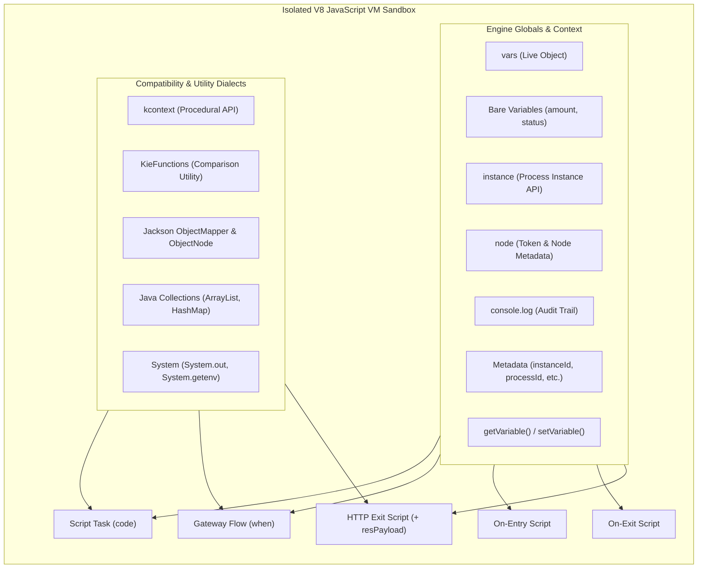
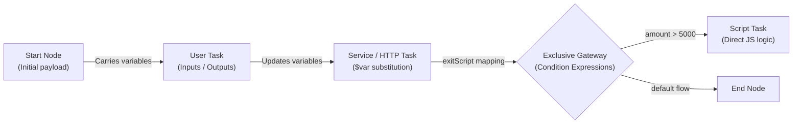

# Consolidated JavaScript & Flow Variables Master Cheat Sheet

A complete, exhaustive reference for writing JavaScript scripts, conditions, data mappings, and manipulating workflow state across the Workflow Engine.

---

## 1. Quick Reference: Where Can You Write JavaScript?

| Execution Context | Location | Purpose | Available Globals & Execution Environment |
|---|---|---|---|
| **Script Task** | Canvas node: `script` | Synchronous business logic, data calculations, payload transformations | Bare process variables, `vars`, `getVariable()`, `setVariable()`, `instance`, `node`, `console`, `env`, `kcontext`, `KieFunctions`, `System`, Jackson & Java collection shims |
| **Gateway Sequence Flow** | Sequence flow: `condition` (`exclusive` / `inclusive`) | Boolean routing decision determining token flow path | All Script Task globals (must evaluate to `true` or `false`) |
| **On-Entry Script** | Any activity: `onEntry` | Pre-execution preparation (e.g. building `reqPayload` before HTTP call) | All Script Task globals |
| **On-Exit Script** | Any activity: `onExit` | Post-execution normalization (e.g. inspecting results, error audits) | All Script Task globals |
| **Service Task Exit Script** | Service node: `exitScript` | HTTP response processing and state updates | All Script Task globals **+ `resPayload`** (raw HTTP response text) |
| **Data Mappings** | Tasks (`userTask`, `call`, `forEach`) | Cross-node input / output variable passing | Process variable names, `$varName` interpolation, property paths |



---

## 2. In-Built Top-Level Variables & Metadata Identifiers

The engine automatically binds key runtime metadata directly to top-level globals in every script and condition:

| Identifier | Type | Description | Example |
|---|---|---|---|
| `instanceId` | `string` | Unique UUID of the executing process instance | `"pi-903b41-e1"` |
| `processId` | `string` | Process definition ID | `"order-fulfillment-process"` |
| `processName` | `string` | Display name of the process definition | `"Order Fulfillment Workflow"` |
| `correlationKey` | `string` | Business correlation key (e.g. Policy #, Order ID) | `"ORD-2026-98124"` |
| `parentInstanceId` | `string` | Parent process instance ID (if running inside Call Activity / Subprocess) | `"pi-parent-001"` or `""` |
| `currentNodeId` | `string` | Canvas definition ID of the current node | `"task_validate_order"` |
| `currentNodeName` | `string` | Display name of the current node | `"Validate Order Payload"` |
| `resPayload` | `string` | Raw HTTP response body as string (*HTTP task exitScript only*) | `'{"status":"APPROVED","txId":"992"}'` |
| `reqPayload` | `string` | Standard variable used to store outgoing HTTP request body | `reqPayload = JSON.stringify(body);` |

---

## 3. Process Variables: 4 Supported Access Styles

All four styles read and write the **exact same underlying process instance state**.

### Style 1: Modern Bare Variables (Recommended)
Declared process variables are injected directly into scope as local identifiers:

```javascript
// Reading bare variables:
if (amount > 1000) {
  // Writing bare variables (assign directly without 'var', 'let', or 'const'):
  status = "NEEDS_APPROVAL";
  discount = amount * 0.15;
}

// Scratch / local variables (use 'const' or 'let' so they remain private to this node):
const calculationFactor = 1.05;
const tempValue = amount * calculationFactor;
```

> [!IMPORTANT]
> **Variable Assignment Rule**:
> - Assigning without a keyword (`status = "APPROVED"`) saves the variable to the workflow instance state.
> - Declaring with `const` or `let` (`const temp = 1;`) keeps the variable local to the script, preventing unwanted variable pollution.

---

### Style 2: The `vars` Object (Recommended for Nested JSON)
The `vars` object is the live reference to the process variables dictionary:

```javascript
// Reading nested structures:
const claimantName = vars.claim.claimant.fullName;

// Mutating nested properties:
vars.claim.payout = 4500;
vars.claim.adjudicatedAt = new Date().toISOString();

// Dynamic or hyphenated keys:
vars["custom-header-key"] = "Value-123";
```

---

### Style 3: Functional Helpers (`getVariable` / `setVariable`)
Clean top-level functions available globally:

```javascript
const tier = getVariable("riskTier");
setVariable("approvalLevel", tier === "HIGH" ? 3 : 1);
```

---

### Style 4: Procedural Compatibility (`kcontext`)
Available for workflows migrated from legacy procedural engines:

```javascript
var amt = kcontext.getVariable("claimAmount");
kcontext.setVariable("payout", amt - 100);
```

---

## 4. Engine Instance API (`instance`)

Every script and condition has access to the comprehensive `instance` object:

### Properties:
| Property | Type | Description | Example |
|---|---|---|---|
| `instance.id` | `string` | Process instance UUID | `instance.id` |
| `instance.processId` | `string` | Process definition ID | `"claims-process"` |
| `instance.processName` | `string` | Process display name | `"Claims Adjudication"` |
| `instance.correlationKey` | `string` | Business correlation key | `"POL-12345"` |
| `instance.parentId` | `string \| undefined` | Parent instance UUID | `instance.parentId` |
| `instance.state` | `string` | Status: `'running'`, `'waiting'`, `'completed'`, `'aborted'`, `'suspended'` | `if (instance.state === 'running')` |
| `instance.variables` | `object` | Direct reference to variables dictionary | `instance.variables.amount` |
| `instance.activeNodes` | `Array<{id, nodeId, name}>` | Active tokens and nodes currently being executed | `instance.activeNodes` |

### Methods:
| Method | Return | Description | Example |
|---|---|---|---|
| `instance.getVariable(name)` | `any` | Gets variable value | `instance.getVariable("tier")` |
| `instance.setVariable(name, val)` | `void` | Sets variable value | `instance.setVariable("tier", "GOLD")` |
| `instance.hasVariable(name)` | `boolean` | Checks if variable exists | `instance.hasVariable("tier")` |
| `instance.getNodeInstances()` | `Array<NodeInstance>` | Returns snapshot of active node instances | `instance.getNodeInstances()` |
| `instance.signal(type, payload)` | `void` | Signals **THIS** instance (resumes waiting catch event) | `instance.signal("DocUploaded", { id: 1 })` |
| `instance.signalOther(targetId, type, payload)` | `void` | Delivers signal to another process instance by ID | `instance.signalOther(childId, "Resume")` |
| `instance.broadcast(type, payload)` | `void` | Broadcasts signal to **all** listening instances | `instance.broadcast("SystemAlert")` |
| `instance.abort()` | `void` | Aborts **THIS** instance immediately | `instance.abort()` |
| `instance.abortOther(targetId)` | `void` | Aborts another process instance by ID | `instance.abortOther(childId)` |

---

## 5. Current Node Metadata (`node`)

Provides information about the executing node and token:

| Property / Method | Return | Description | Example |
|---|---|---|---|
| `node.id` / `node.getId()` | `string` | Current execution token UUID | `"tok_39102"` |
| `node.nodeId` / `node.getNodeId()` | `string` | Canvas node definition ID | `"script_validate_order"` |
| `node.name` / `node.getNodeName()` | `string` | Display label of the node | `"Validate Order Payload"` |

```javascript
console.log(`Executing step "${node.getNodeName()}" [ID: ${node.getNodeId()}] on token ${node.getId()}`);
```

---

## 6. Procedural Compatibility API (`kcontext`)

Provides complete parity with traditional workflow engines:

### `kcontext` Root Methods:
- `kcontext.getVariable(name: string): any` — reads process variable
- `kcontext.setVariable(name: string, value: any): void` — writes process variable
- `kcontext.getProcessInstance(): ProcessInstance` — returns process instance handle
- `kcontext.getNodeInstance(): NodeInstance` — returns node instance handle
- `kcontext.getKieRuntime(): KieRuntime` — returns runtime execution context

### `kcontext.getProcessInstance()` Methods:
- `.getId(): string` — instance ID
- `.getProcessId(): string` — process definition ID
- `.getProcessName(): string` — process display name
- `.getCorrelationKey(): string` — business correlation key
- `.getParentProcessInstanceId(): string | null` — parent instance ID
- `.getState(): number` — status integer (`0: PENDING`, `1: ACTIVE`, `2: COMPLETED`, `3: ABORTED`, `4: SUSPENDED`)
- `.getVariables(): Map<string, any>` — live variables map
- `.getNodeInstances(): List<NodeInstance>` — active node instances snapshot
- `.signalEvent(type: string, event: any): void` — delivers signal to THIS instance

### `kcontext.getNodeInstance()` Methods:
- `.getId(): string` — node token ID
- `.getNodeId(): string` — node definition ID
- `.getNodeName(): string` — node display name

### `kcontext.getKieRuntime()` Methods:
- `.getEnvironment(): Environment` — access environment (`.get(key)`)
- `.signalEvent(type: string, event: any): void` — session-wide signal broadcast
- `.signalEvent(type: string, event: any, processInstanceId: string): void` — targeted signal
- `.abortProcessInstance(processInstanceId: string): void` — aborts process instance by ID

---

## 7. `KieFunctions` Complete Method Catalog

Pre-bound utility object for common enterprise comparisons and boundary checks:

| Method | Return | Description | Example |
|---|---|---|---|
| `KieFunctions.equalsTo(a, b)` | `boolean` | Safe equality check with string coercion | `KieFunctions.equalsTo(status, "APPROVED")` |
| `KieFunctions.isTrue(a)` | `boolean` | Checks if `a` is boolean `true`, `"true"`, or `"1"` | `KieFunctions.isTrue(isVip)` |
| `KieFunctions.isFalse(a)` | `boolean` | Checks if `a` is boolean `false`, `"false"`, or `"0"` | `KieFunctions.isFalse(isBlocked)` |
| `KieFunctions.isNull(a)` | `boolean` | Checks if `a == null` (null or undefined) | `KieFunctions.isNull(middleName)` |
| `KieFunctions.notNull(a)` | `boolean` | Checks if `a != null` | `KieFunctions.notNull(accountNumber)` |
| `KieFunctions.isEmpty(a)` | `boolean` | Checks if string, array, or object is empty | `KieFunctions.isEmpty(itemsList)` |
| `KieFunctions.contains(container, value)` | `boolean` | Checks array inclusion, string substring, or Set `.contains()` | `KieFunctions.contains(roles, "ADMIN")` |
| `KieFunctions.startsWith(str, prefix)` | `boolean` | Checks string prefix | `KieFunctions.startsWith(claimId, "CLM-")` |
| `KieFunctions.endsWith(str, suffix)` | `boolean` | Checks string suffix | `KieFunctions.endsWith(fileName, ".pdf")` |
| `KieFunctions.greaterThan(a, b)` | `boolean` | Numeric `a > b` | `KieFunctions.greaterThan(amount, 5000)` |
| `KieFunctions.greaterOrEqualThan(a, b)` | `boolean` | Numeric `a >= b` | `KieFunctions.greaterOrEqualThan(score, 700)` |
| `KieFunctions.lessThan(a, b)` | `boolean` | Numeric `a < b` | `KieFunctions.lessThan(days, 30)` |
| `KieFunctions.lessOrEqualThan(a, b)` | `boolean` | Numeric `a <= b` | `KieFunctions.lessOrEqualThan(retryCount, 3)` |
| `KieFunctions.between(val, min, max)` | `boolean` | Range check: `val >= min && val <= max` | `KieFunctions.between(age, 18, 65)` |

---

## 8. Jackson JSON Tree API (`com.fasterxml.jackson.databind`)

The sandbox provides full shims for Jackson JSON node manipulation:

### `ObjectMapper`:
```javascript
var mapper = new com.fasterxml.jackson.databind.ObjectMapper();

// 1. Create empty ObjectNode:
var root = mapper.createObjectNode();

// 2. Create empty ArrayNode:
var array = mapper.createArrayNode();

// 3. Parse JSON string into ObjectNode:
var parsed = mapper.readTree(resPayload);

// 4. Serialize object to JSON string:
var jsonStr = mapper.writeValueAsString(root);
```

### `ObjectNode` Methods:
- `.put(key, value)` — sets string, number, or boolean property
- `.putPOJO(key, value)` — sets arbitrary object or list
- `.putNull(key)` — sets property to `null`
- `.putArray(key)` — creates and attaches an `ArrayNode`
- `.set(key, node)` — sets child node
- `.get(key)` — gets child property (returns `undefined` if missing)
- `.path(key)` — **safe chained navigation**: returns a missing node instead of crashing
- `.has(key): boolean` — checks if property exists
- `.hasNonNull(key): boolean` — checks if property exists and is not null
- `.asText(fallback = ''): string` — extracts string value safely
- `.asBoolean(fallback = false): boolean` — extracts boolean value safely
- `.asInt(fallback = 0): number` — extracts integer value safely
- `.isNull(): boolean` — checks if node represents null
- `.isMissingNode(): boolean` — checks if node is missing from tree
- `.size(): number` — count of fields
- `.toString(): string` — serializes to JSON string

### Jackson Example:
```javascript
var mapper = new com.fasterxml.jackson.databind.ObjectMapper();
var req = mapper.createObjectNode();
req.put("caseId", kcontext.getVariable("caseId"));
req.put("priority", 1);

var items = req.putArray("items");
items.add("Item-A").add("Item-B");

kcontext.setVariable("reqPayload", req.toString());

// Safe navigation:
var tree = mapper.readTree(resPayload);
var status = tree.path("data").path("approval").asText("PENDING");
```

---

## 9. Java Collections in JavaScript (`java.util.*` & `Java.type(...)`)

Imported workflows constructing Java collections execute seamlessly:

```javascript
// ArrayList / LinkedList:
var list = new java.util.ArrayList();
// Or via GraalVM Java.type():
var ArrayList = Java.type("java.util.ArrayList");
var list2 = new ArrayList();

list.add("First");
list.add("Second");
var item = list.get(0);
var count = list.size();
var hasItem = list.contains("First");
list.remove(0);

// HashMap / LinkedHashMap:
var map = new java.util.HashMap();
map.put("key1", "value1");
var val = map.get("key1");
var exists = map.containsKey("key1");
var keys = map.keySet();
var values = map.values();

// HashSet:
var set = new java.util.HashSet();
set.add("TAG_1");
var hasTag = set.contains("TAG_1");
```

---

## 10. `org.json` Compatibility

Full support for `org.json.JSONObject` and `JSONArray`:

```javascript
var json = new org.json.JSONObject();
json.put("orderId", "ORD-123");
json.put("amount", 250.50);

var id = json.getString("orderId");
var status = json.optString("status", "NEW");
var active = json.optBoolean("active", true);

var payloadStr = json.toString();
```

---

## 11. System, Environment & Logging

### Console & Audit Trail:
Any call to `console.log(...)` is captured in real-time and saved directly into the process instance execution audit timeline:
```javascript
console.log(`Processing claim ${instance.correlationKey} with amount ${amount}`);
console.log("Detailed payload:", JSON.stringify(vars.claim));
```

### System Object:
- `System.out.println(...)` / `System.out.print(...)` — routes directly to execution audit log
- `System.getenv(key)` — reads environment variable
- `System.getProperty(key)` — reads system property or environment setting
- `System.currentTimeMillis()` — returns current epoch timestamp in milliseconds

### `env` Global:
Provides direct access to runtime environment variables:
```javascript
const apiUrl = env.INTEGRATION_URL || "https://api.internal";
```

---

## 12. Primitive Boxed Types & Prototype Extensions

### Boxed Type Shims:
- `Integer.valueOf(x)` / `Integer.parseInt(x)`
- `Long.valueOf(x)` / `Long.parseLong(x)`
- `Double.valueOf(x)` / `Double.parseDouble(x)`
- `Float.valueOf(x)` / `Float.parseFloat(x)`
- `Boolean.TRUE` / `Boolean.FALSE`
- `String.valueOf(x)`

### Prototype Enhancements in VM:
- **`String.prototype`**:
  - `.isEmpty()` — returns `this.trim().length === 0`
  - `.equals(other)` — returns `this === String(other)`
  - `.equalsIgnoreCase(other)` — case-insensitive equality
- **`Array.prototype`**:
  - `.isEmpty()` — returns `this.length === 0`
  - `.size()` — returns `this.length`
  - `.get(index)` — returns `this[index]`
  - `.set(index, value)` — sets element at index
  - `.add(value)` — appends item
  - `.remove(indexOrValue)` — removes by index or value
  - `.contains(value)` — returns `this.includes(value)`
- **`Object.prototype`**:
  - `.isEmpty()`, `.equals(other)`, `.has(key)`, `.hasNonNull(key)`, `.path(key)`, `.asText()`, `.asBoolean()`, `.asInt()`, `.size()`
- **`Error.prototype`**:
  - `.getMessage()`, `.getLocalizedMessage()`, `.printStackTrace()`

---

## 13. Gateway Sequence Flow Condition Syntax & Recipes

Sequence flows leaving **Exclusive (XOR)** or **Inclusive (OR)** Gateways evaluate a boolean expression.

### Syntax Rules:
1. Must return a boolean (`true` or `false`).
2. Single-line expressions are automatically wrapped with `return (...)`.
3. Multi-line logic must include an explicit `return <boolean>;`.

### Common Condition Recipes:
```javascript
// 1. Numeric Comparison
amount > 5000

// 2. Compound Boolean Logic
riskTier === "HIGH" && creditScore < 650

// 3. KieFunctions Usage
KieFunctions.greaterThan(amount, 10000) && KieFunctions.equalsTo(claimType, "DEATH")

// 4. Nested Property Check
vars.claim.payout > 10000 || vars.policy.isVIP === true

// 5. String Pattern Matching
customerType.startsWith("CORP_") || email.endsWith("@prudential.com")

// 6. Array Membership Check
tags.includes("HIGH_RISK") || roles.some(r => r === "SUPERVISOR")

// 7. Multi-Line Condition Block
const netAmount = requestedAmount - deductible;
return netAmount > 25000 && riskRating !== "LOW";
```

---

## 14. Data Mapping & Variable Flow Between Nodes

Flow variables are carried by the process instance throughout its entire lifecycle.



### A. User Task Form Mappings:
- **Inputs**: Map process variables into task form fields:
  ```json
  { "claimNumber": "caseId", "claimantName": "vars.customer.name", "amount": "amount" }
  ```
- **Outputs**: Map form submission values back into process variables upon task completion:
  ```json
  { "reviewDecision": "status", "managerNotes": "approvalRemarks" }
  ```

### B. Service (HTTP) Task String Interpolation:
Prefix variables with `$` inside URL, headers, or body:
- **URL**: `https://api.internal/claims/$caseId/payout`
- **Headers**: `{ "X-Correlation-ID": "$correlationKey", "Authorization": "Bearer $token" }`
- **Request Body**: `{ "amount": $amount, "policyNumber": "$policyNumber" }`
- **Result Variable (`resultTo`)**: Stores parsed JSON response directly into a process variable name (e.g. `apiResult`).

### C. Subprocess & Call Activity Mappings:
- **`inputMappings`**: `{ "childCaseId": "caseId", "childAmount": "amount" }` — copies variables from parent to child upon spawning.
- **`outputMappings`**: `{ "parentStatus": "childStatus" }` — copies variables from child back to parent upon completion.
