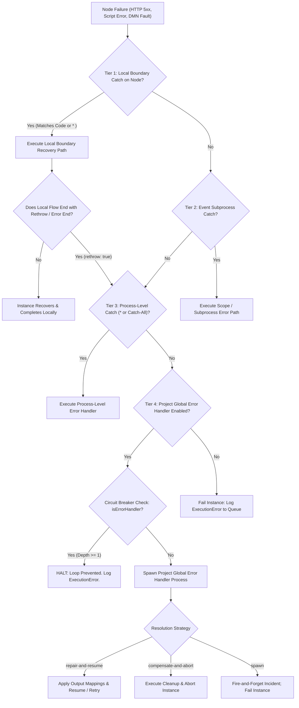

# 17. Hierarchical Error Handling & Environment Variables Guide

This comprehensive guide details the **Hierarchical Error Handling Architecture** and **Project Environment Variables (`env`)** system within the Prudential BPM engine.

In enterprise BPM and real-world microservice architectures (such as the Prudential Policy Management System), error handling cannot be a simplistic one-size-fits-all mechanism. Workflows require fine-grained local recovery on sensitive tasks (e.g., REST calls, external payment gateways) while ensuring that any unhandled or fatal exceptions are reliably caught by a centralized **Project Global Error Handler** without infinite loops.

---

## 1. Architectural Overview: The 4-Tier Error Hierarchy

In legacy jBPM, configuring an `ExecutionErrorHandler` or global `WorkItemHandler` interceptor frequently broke or bypassed local `BoundaryErrorEvent` logic because the interceptor swallowed or aborted the task before the BPMN engine could evaluate the node's local boundary catches.

In this engine, **both local and global error handlers work together seamlessly**:



### Order of Precedence
1. **Tier 1: Local Boundary Error Event**: Attached directly to the failing activity node (`on: ['node_id']`). Matches specific error code (e.g., `SERVICE_ERROR`, `WorkItemHandlerRuntimeException`) or `*`. If present, **local handling executes immediately and the global error handler is never invoked**.
2. **Tier 2: Scope Event Subprocess**: If the failing node is inside an embedded subprocess, an Event Subprocess within that scope intercepts the error before it escapes to parent tokens.
3. **Tier 3: Process-Level Error Catch**: Any catch node configured with `on: '*'` or an Event Subprocess at the root of the process definition.
4. **Tier 4: Project Global Error Handler**: If no local or process catch handles the fault (or if the local handler deliberately rethrows via `rethrow: true` / Error End Event), execution bubbles up to the **Project Global Error Handler** process configured in Project Settings.

---

## 2. Structured Error Context Schema

When an error occurs, the engine constructs enriched error payloads for both local instance variables (`errorInfo`) and the Global Error Handler process (`errorContext` + convenience variables).

### Local Payload: `inst.variables.errorInfo`
Every caught error automatically populates `errorInfo` in the instance's variables:
```json
{
  "code": "SERVICE_ERROR",
  "node": "_REST_TASK",
  "nodeName": "Call Policy Microservice",
  "nodeType": "http",
  "message": "HTTP 502 from https://api.internal/policies: Bad Gateway",
  "details": {
    "httpStatus": 502,
    "statusText": "Bad Gateway",
    "url": "https://api.internal/policies",
    "method": "POST",
    "responseBody": { "code": "GATEWAY_TIMEOUT", "traceId": "c92841" },
    "headers": {
      "content-type": "application/json",
      "x-request-id": "req-991823"
    }
  },
  "at": "2026-10-30T00:45:00.000Z"
}
```

### Global Payload: Variables Injected into Global Error Process
When the Project Global Error Handler process is spawned, it receives the following variables:

| Variable Name | Type | Description |
| :--- | :--- | :--- |
| `failedContext` | `String (JSON)` | Serialized JSON string containing the full `errorContext` snapshot. **Directly matches real-world jBPM projects like `policy_system`'s `api-error-handler.bpmn`!** |
| `errorContext` | `Object` | Parsed object containing `failedInstanceId`, `workflowId`, `deploymentId`, `processId`, `nodeId`, `nodeName`, `nodeType`, `errorCode`, `errorMessage`, `details`, and `failedVariables`. |
| `failedEndpoint` | `String` | The target URL for HTTP service task failures. |
| `failedPayload` | `String` | Raw string or JSON string of the failed response or request payload. |
| `failedMethod` | `String` | HTTP method verb (`POST`, `GET`, etc.). |
| `failedHeaders` | `String` | Stringified HTTP headers. |
| `failedNodeId` | `String` | ID of the failing node in the original process. |
| `errorCode` | `String` | Error code (`SERVICE_ERROR`, `SCRIPT_ERROR`, `RULE_ERROR`, etc.). |
| `errorMessage` | `String` | Error message description. |
| `errorInfo` | `Object` | Structured error info object. |
| `...failedVariables` | `Any` | All variable values from the failed instance snapshot (available as fallbacks). |

---

## 3. Global Error Handler Strategies & Variable Mapping

In **Project Settings** (`ProjectSettingsComponent`), projects can choose from three resolution strategies:

### Strategy 1: `repair-and-resume` (Recommended)
Used when the error handler can fix the fault (e.g., refreshing an expired OAuth token, fetching a cached fallback, or alerting an operator for parameter correction).

1. The Global Error Handler executes its flow.
2. When the error handler completes successfully (`status === 'completed'`), the engine maps output variables back to the original instance according to `outputMappings`.
3. The engine clears `inst.error` and sets `inst.variables['errorRepaired'] = true`.
4. Resumption action:
   - **Continue Flow (Default)**: If the error handler computed fallback values, the instance continues past the failing node down its default sequence flows (`outgoing`).
   - **Retry Node (`errorHandlerAction = 'retry'`)**: If the error handler refreshed credentials or fixed input parameters and set `vars.errorHandlerAction = "retry"`, the engine **re-executes the failing node**!

#### Example Output Mappings Configuration:
In Project Settings:
```
Error Process Var          Target Instance Var
-----------------          -------------------
repairedToken       -->    authToken
fallbackResult      -->    policyData
```

### Strategy 2: `compensate-and-abort`
Used when a failure is non-recoverable (e.g., fraud detected, credit denial, unrecoverable data corruption).
1. The Global Error Handler executes cleanup activities (sending failure notifications, rolling back database states, publishing compensation events).
2. The original process instance is transitioned directly to `status = 'aborted'`.
3. Open tasks and timers belonging to the instance are immediately cancelled.

### Strategy 3: `spawn` (Fire-and-Forget Incident)
Spawns the global error process as an asynchronous operational incident for support team triage, while marking the original instance as `status = 'failed'`.

---

## 4. Recursion Prevention: The Circuit Breaker

A critical challenge in workflow error handling is recursion loops: **What happens if the Global Error Handler itself throws an error?**

Without strict controls, an error in the global error handler would trigger the global error handler again, causing infinite database row creation, memory leaks, and worker process lockup.

### Circuit Breaker Implementation:
1. When any Global Error Handler instance is initialized, the engine marks it with:
   ```ts
   handlerInst.isErrorHandler = true;
   handlerInst.handlingInstanceId = inst.id;
   ```
2. When any node fails in any process, `execution-engine.ts` checks:
   ```ts
   if (inst.isErrorHandler) {
     // HARD CIRCUIT BREAKER TRIPPED!
     // Recursion depth is strictly capped at 1.
     return false; // Terminates error propagation immediately!
   }
   ```
3. The handler instance halts with status `failed`, writes an `ExecutionError` record to the operational queue, and **under no circumstances will it trigger another global error process**.

---

## 5. Task & Boundary Flags

### Flag 1: `throwError: boolean` (Soft Failure vs Hard Error)
Configured on **Service (REST) Tasks** (`http` nodes):
- `throwError: true` (or omitted, Default): Any HTTP 4xx, 5xx, or network failure throws an engine `SERVICE_ERROR` that routes to local boundary catches or the global error handler.
- `throwError: false` (or `handleResponseErrors: false`): Soft Failure. The node **does not fail**. Instead:
  - Details `{ httpStatus, responseBody, url, method }` are written to `n.errorVar` (defaults to `serviceError`).
  - Sequence flow continues normally down the outgoing flow.
  - Subsequent gateway conditions can inspect `if (serviceError != null)`.

### Flag 2: `rethrow: boolean` on Boundary & Error End Events
Configured on **Boundary Events** and **Error End Events**:
- When `rethrow: true` is set on an Error End event or Boundary catch, the engine bypasses local boundary catches and directly escalates the error to parent subprocesses and the **Project Global Error Handler**.

---

## 6. Real-World Case Study: Policy Management System

In the Prudential Policy System (`extracted_projects/policy_system`):
- `rest-executor.bpmn` executes a REST call to an external core policy service.
- It attaches a local boundary error event:
  `<bpmn2:boundaryEvent id="_B_ERROR" attachedToRef="_REST_TASK">`
- The boundary catch executes `_CALL_ERR` which calls `policy_system.api-error-handler`:

```java
// Inside api-error-handler.bpmn:
String ctx = (String) kcontext.getVariable("failedContext");
if (ctx != null && !ctx.isEmpty()) {
    com.fasterxml.jackson.databind.JsonNode node = 
        new com.fasterxml.jackson.databind.ObjectMapper().readTree(ctx);
    String endpoint = node.get("url").asText();
    String method = node.get("method").asText();
    kcontext.setVariable("failedEndpoint", endpoint);
}
int count = (int) kcontext.getVariable("retryCount");
kcontext.setVariable("retryCount", count + 1);
```

- If `retryCount < maxRetryCount`, it waits on a timer and retries.
- If retries are exhausted, it throws `TERMINATE_CASE`, terminating the policy agreement cleanly.

With our engine:
- If a local boundary is defined on `_REST_TASK`, it runs locally.
- If an unhandled REST error occurs in any other node in the project, the **Project Global Error Handler** catches it, passes `failedContext`, and executes `api-error-handler.bpmn` without requiring boilerplate boundary nodes on every single task!

---

## 7. Project Environment Variables (`env`)

In enterprise jBPM, environment variables and configuration properties were managed via server-level `-D` system properties or KIE workbench profiles.

In this engine, environment variables are managed directly at the **Project Level** and automatically inherited by every deployment:

### Setting Environment Variables in UI:
1. Navigate to **Projects** &rarr; Select your Project &rarr; Click **Project Settings**.
2. Scroll to the **Environment Variables (env)** section.
3. Click **+ Add Environment Variable**.
4. Enter the `KEY` (e.g. `INTEGRATION_LAYER_URL`, `TIMEOUT_SECONDS`, `API_KEY`) and `VALUE`.
5. Click **Save environment variables**.

### Deployment Inheritance:
When deploying a project via `DeploymentService.deploy`:
```ts
const workflow = await this.wf().get(v.workflowId);
const mergedEnv = { ...(workflow?.env || {}), ...(input.env || {}) };
```
Every active deployment inherits the project's environment variables, while allowing environment-specific overrides (e.g., `dev` vs `staging` vs `prod`).

### Accessing Environment Variables at Runtime:

#### In Pure JavaScript (`lang: "js"`):
```js
// 1. Direct env global
const baseUrl = env.INTEGRATION_LAYER_URL || 'http://localhost:3000';
const apiKey = env.API_KEY;

// 2. Standard System.getenv
const timeout = System.getenv("TIMEOUT_SECONDS");

// 3. System.getProperty
const region = System.getProperty("AWS_REGION");
```

#### In Java / Imported Scripts (`lang: "java"` in JVM Sidecar):
```java
// 1. System.getenv
String baseUrl = System.getenv("INTEGRATION_LAYER_URL");

// 2. System.getProperty
String envName = System.getProperty("ENVIRONMENT");

// 3. KIE Runtime Environment (Real jBPM Parity)
String url = (String) kcontext.getKieRuntime().getEnvironment().get("INTEGRATION_LAYER_URL");
```

#### In Service (REST) Tasks (`http` nodes):
Relative URLs (e.g. `/v1/policies`) automatically prepend `INTEGRATION_LAYER_URL` from the deployment environment:
```ts
const baseUrl = (c.dep.env && c.dep.env['INTEGRATION_LAYER_URL']) || config.integrationBaseUrl;
const url = isAbsolute ? n.url : `${baseUrl}${n.url}`;
```

---

## 8. Summary Checklist for Error Handling & Configuration

| Feature | Local Boundary Catch | Project Global Error Handler |
| :--- | :--- | :--- |
| **Scope** | Single activity node | Entire Project / Workflow |
| **Precedence** | Always runs first (Tier 1) | Runs if unhandled locally (Tier 4) |
| **Trigger Criteria** | Error code or `*` | Filter array (e.g. `['SERVICE_ERROR', '500']` or `['*']`) |
| **Output Mapping** | Direct flow variables | Configured `outputMappings` table |
| **Resumption** | Continues along boundary flow | `repair-and-resume` (with optional retry) |
| **Loop Protection** | BPMN sequence flow structure | Hard Circuit Breaker (`depth = 1`) |
| **Configuration Location**| Node Canvas & Properties Panel | Project Settings Card |
