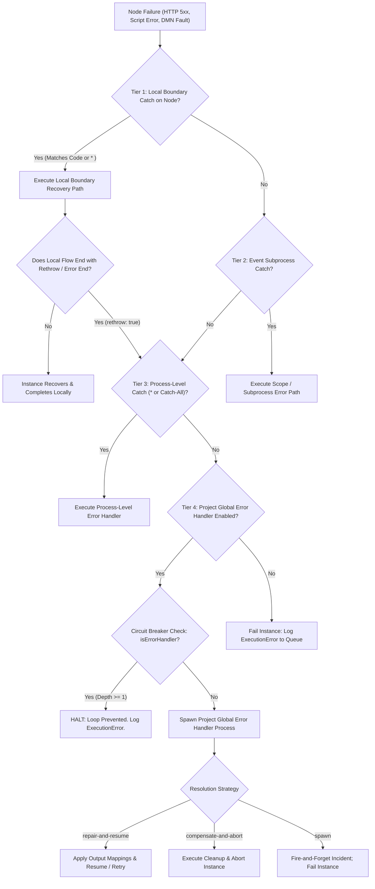
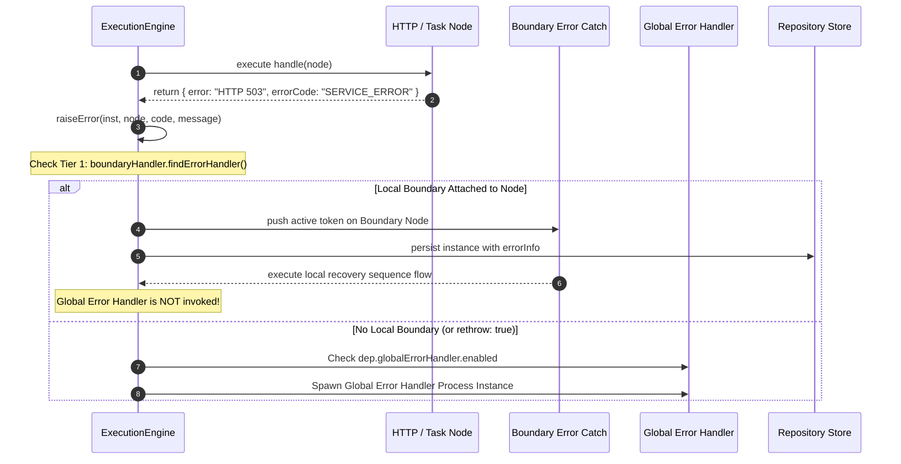
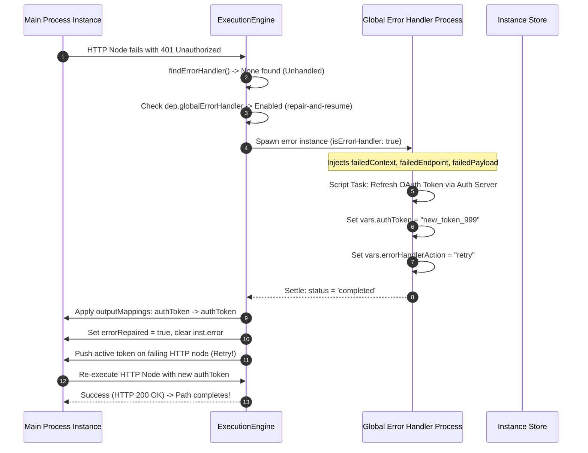
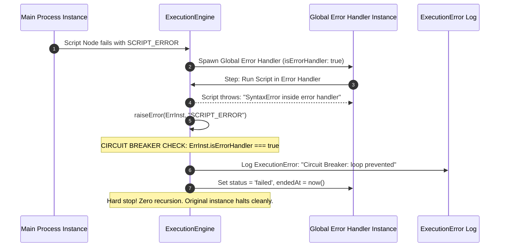
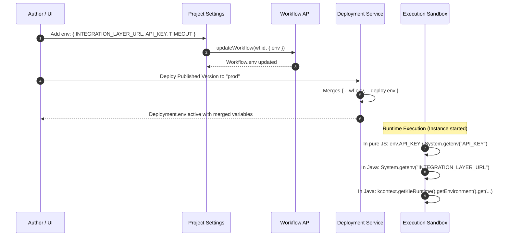
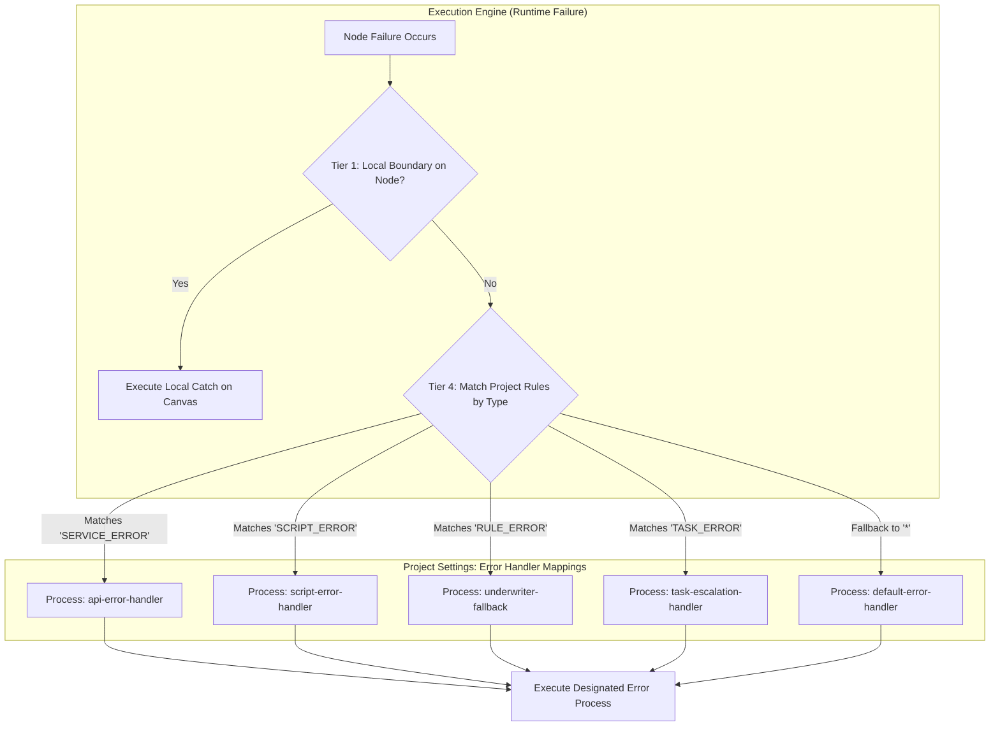
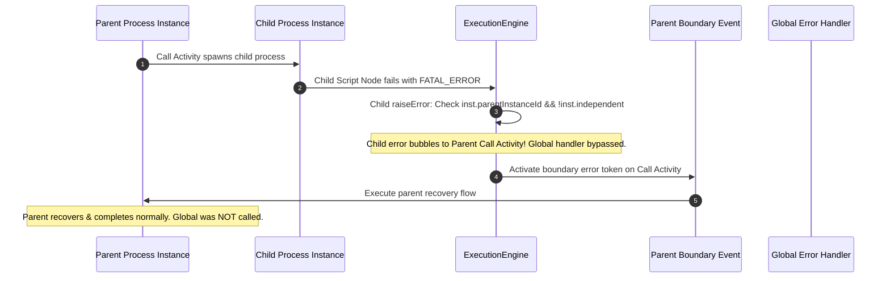
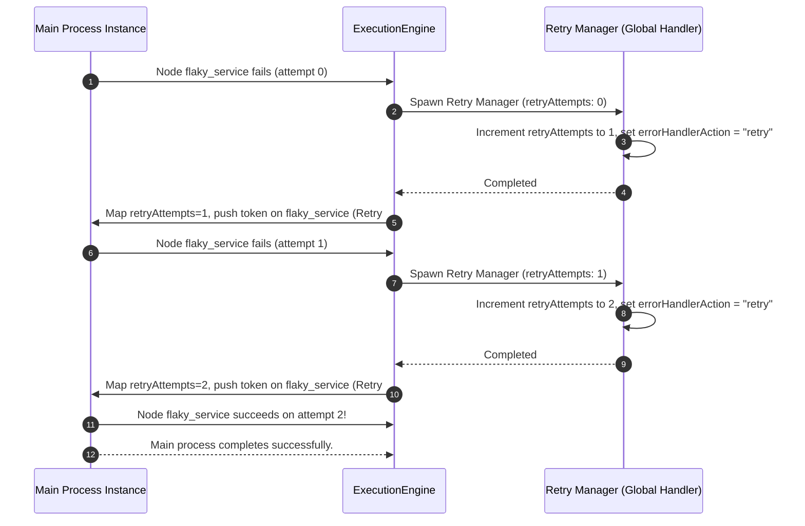
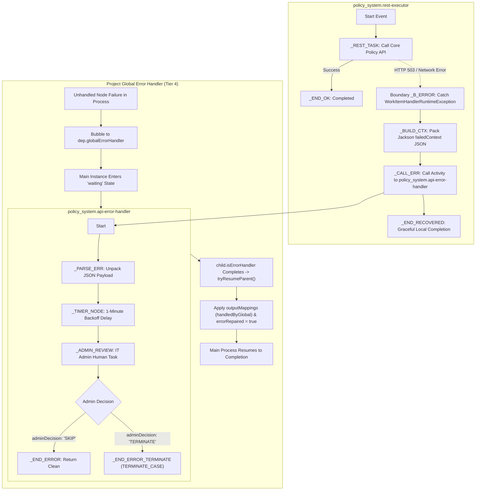

# 17. Hierarchical Error Handling & Environment Variables Guide

This comprehensive guide details the **Hierarchical Error Handling Architecture** and **Project Environment Variables (`env`)** system within the Prudential BPM engine.

In enterprise BPM and real-world microservice architectures (such as the Prudential Policy Management System), error handling cannot be a simplistic one-size-fits-all mechanism. Workflows require fine-grained local recovery on sensitive tasks (e.g., REST calls, external payment gateways) while ensuring that any unhandled or fatal exceptions are reliably caught by a centralized **Project Global Error Handler** without infinite loops.

---

## 1. Architectural Overview: The 4-Tier Error Hierarchy

In legacy jBPM, configuring an `ExecutionErrorHandler` or global `WorkItemHandler` interceptor frequently broke or bypassed local `BoundaryErrorEvent` logic because the interceptor swallowed or aborted the task before the BPMN engine could evaluate the node's local boundary catches.

In this engine, **both local and global error handlers work together seamlessly**:



### Order of Precedence
1. **Tier 1: Local Boundary Error Event**: Attached directly to the failing activity node (`on: ['node_id']`). Matches specific error code (e.g., `SERVICE_ERROR`, `WorkItemHandlerRuntimeException`) or `*`. If present, **local handling executes immediately and the global error handler is never invoked**.
2. **Tier 2: Scope Event Subprocess**: If the failing node is inside an embedded subprocess, an Event Subprocess within that scope intercepts the error before it escapes to parent tokens.
3. **Tier 3: Process-Level Error Catch**: Any catch node configured with `on: '*'` or an Event Subprocess at the root of the process definition.
4. **Tier 4: Project Global Error Handler**: If no local or process catch handles the fault (or if the local handler deliberately rethrows via `rethrow: true` / Error End Event), execution bubbles up to the **Project Global Error Handler** process configured in Project Settings.

---

## 2. Sequence Diagrams: Execution Workflows

### Sequence 1: Local Boundary Precedence vs. Global Bubbling

This sequence illustrates how a local boundary error event intercepts a failure locally, preventing invocation of the Project Global Error Handler:



---

### Sequence 2: Global Error Handler with `repair-and-resume` & Node Retry

This sequence illustrates how an unhandled REST error bubbles up to the Global Error Handler, which repairs the authentication state and triggers a re-execution of the failing node:



---

### Sequence 3: Circuit Breaker Loop Prevention

This sequence illustrates how the engine prevents infinite recursive loops when an error occurs inside the Global Error Handler process itself:



---

### Sequence 4: Project Environment Variables (`env`) Lifecycle

This sequence illustrates how arbitrary project environment variables are defined, deployed, and accessed in JavaScript and Java sandboxes:



---

## 3. Structured Error Context Schema

When an error occurs, the engine constructs enriched error payloads for both local instance variables (`errorInfo`) and the Global Error Handler process (`errorContext` + convenience variables).

### Local Payload: `inst.variables.errorInfo`
Every caught error automatically populates `errorInfo` in the instance's variables:
```json
{
  "code": "SERVICE_ERROR",
  "node": "_REST_TASK",
  "nodeName": "Call Policy Microservice",
  "nodeType": "http",
  "message": "HTTP 502 from https://api.internal/policies: Bad Gateway",
  "details": {
    "httpStatus": 502,
    "statusText": "Bad Gateway",
    "url": "https://api.internal/policies",
    "method": "POST",
    "responseBody": { "code": "GATEWAY_TIMEOUT", "traceId": "c92841" },
    "headers": {
      "content-type": "application/json",
      "x-request-id": "req-991823"
    }
  },
  "at": "2026-10-30T00:45:00.000Z"
}
```

### Global Payload: Variables Injected into Global Error Process
When the Project Global Error Handler process is spawned, it receives the following variables:

| Variable Name | Type | Description |
| :--- | :--- | :--- |
| `failedContext` | `String (JSON)` | Serialized JSON string containing the full `errorContext` snapshot. **Directly matches real-world jBPM projects like `policy_system`'s `api-error-handler.bpmn`!** |
| `errorContext` | `Object` | Parsed object containing `failedInstanceId`, `workflowId`, `deploymentId`, `processId`, `nodeId`, `nodeName`, `nodeType`, `errorCode`, `errorMessage`, `details`, and `failedVariables`. |
| `failedEndpoint` | `String` | The target URL for HTTP service task failures. |
| `failedPayload` | `String` | Raw string or JSON string of the failed response or request payload. |
| `failedMethod` | `String` | HTTP method verb (`POST`, `GET`, etc.). |
| `failedHeaders` | `String` | Stringified HTTP headers. |
| `failedNodeId` | `String` | ID of the failing node in the original process. |
| `errorCode` | `String` | Error code (`SERVICE_ERROR`, `SCRIPT_ERROR`, `RULE_ERROR`, etc.). |
| `errorMessage` | `String` | Error message description. |
| `errorInfo` | `Object` | Structured error info object. |
| `...failedVariables` | `Any` | All variable values from the failed instance snapshot (available as fallbacks). |

---

## 4. Multi-Type Global Error Handlers & Variable Mapping

In enterprise BPM, a single catch-all dropdown is insufficient because different failure domains demand different operational responses. In standard BPMN, business processes remain completely clean on canvas (e.g. `Start → Risky → End Normal`) without artificial error nodes.

In **Project Settings** (`ProjectSettingsComponent`), projects configure **Error Handlers by Error Type**:



### Pre-Configured Error Types:
- **`SERVICE_ERROR`**: REST API failures, HTTP 5xx/4xx, network timeouts, or WorkItemHandler exceptions (`WorkItemHandlerRuntimeException`).
- **`SCRIPT_ERROR`**: JavaScript sandbox exceptions, syntax errors, or Java runtime crashes.
- **`RULE_ERROR`**: DMN decision table missing references, scorecard calculation faults, or Drools fact evaluation errors.
- **`TASK_ERROR`**: Human task deadline expirations, assignment failures, or SLA violations.
- **`*` (Catch-All / Default)**: Any unhandled exception not matched by a specific rule.
- **`Custom Code`**: Any arbitrary BPMN error code or specific HTTP status code (e.g. `503`, `PAYMENT_GATEWAY_TIMEOUT`).

For each configured rule, administrators select:
1. **Target Error Handler Process**: A standalone BPMN process in the project.
2. **Resolution Strategy**: `repair-and-resume`, `compensate-and-abort`, or `spawn`.
3. **Output Variable Mappings**: Key-value table mapping error process outputs into the target instance before resumption.

### Strategy 1: `repair-and-resume` (Recommended)
Used when the error handler can fix the fault (e.g., refreshing an expired OAuth token, fetching a cached fallback, or alerting an operator for parameter correction).

1. The Global Error Handler executes its flow.
2. When the error handler completes successfully (`status === 'completed'`), the engine maps output variables back to the original instance according to `outputMappings`.
3. The engine clears `inst.error` and sets `inst.variables['errorRepaired'] = true`.
4. Resumption action:
   - **Continue Flow (Default)**: If the error handler computed fallback values, the instance continues past the failing node down its default sequence flows (`outgoing`).
   - **Retry Node (`errorHandlerAction = 'retry'`)**: If the error handler refreshed credentials or fixed input parameters and set `vars.errorHandlerAction = "retry"`, the engine **re-executes the failing node**!

#### Example Output Mappings Configuration:
In Project Settings:
```
Error Process Var          Target Instance Var
-----------------          -------------------
repairedToken       -->    authToken
fallbackResult      -->    policyData
```

### Strategy 2: `compensate-and-abort`
Used when a failure is non-recoverable (e.g., fraud detected, credit denial, unrecoverable data corruption).
1. The Global Error Handler executes cleanup activities (sending failure notifications, rolling back database states, publishing compensation events).
2. The original process instance is transitioned directly to `status = 'aborted'`.
3. Open tasks and timers belonging to the instance are immediately cancelled.

### Strategy 3: `spawn` (Fire-and-Forget Incident)
Spawns the global error process as an asynchronous operational incident for support team triage, while marking the original instance as `status = 'failed'`.

---

## 5. Recursion Prevention: The Circuit Breaker

A critical challenge in workflow error handling is recursion loops: **What happens if the Global Error Handler itself throws an error?**

Without strict controls, an error in the global error handler would trigger the global error handler again, causing infinite database row creation, memory leaks, and worker process lockup.

### Circuit Breaker Implementation:
1. When any Global Error Handler instance is initialized, the engine marks it with:
   ```ts
   handlerInst.isErrorHandler = true;
   handlerInst.handlingInstanceId = inst.id;
   ```
2. When any node fails in any process, `execution-engine.ts` checks:
   ```ts
   if (inst.isErrorHandler) {
     // HARD CIRCUIT BREAKER TRIPPED!
     // Recursion depth is strictly capped at 1.
     return false; // Terminates error propagation immediately!
   }
   ```
3. The handler instance halts with status `failed`, writes an `ExecutionError` record to the operational queue, and **under no circumstances will it trigger another global error process**.

---

## 6. Task & Boundary Flags

### Flag 1: `throwError: boolean` (Soft Failure vs Hard Error)
Configured on **Service (REST) Tasks** (`http` nodes):
- `throwError: true` (or omitted, Default): Any HTTP 4xx, 5xx, or network failure throws an engine `SERVICE_ERROR` that routes to local boundary catches or the global error handler.
- `throwError: false` (or `handleResponseErrors: false`): Soft Failure. The node **does not fail**. Instead:
  - Details `{ httpStatus, responseBody, url, method }` are written to `n.errorVar` (defaults to `serviceError`).
  - Sequence flow continues normally down the outgoing flow.
  - Subsequent gateway conditions can inspect `if (serviceError != null)`.

### Flag 2: `rethrow: boolean` on Boundary & Error End Events
Configured on **Boundary Events** and **Error End Events**:
- When `rethrow: true` is set on an Error End event or Boundary catch, the engine bypasses local boundary catches and directly escalates the error to parent subprocesses and the **Project Global Error Handler**.

---

## 7. Real-World Case Study: Policy Management System

In the Prudential Policy System (`extracted_projects/policy_system`):
- `rest-executor.bpmn` executes a REST call to an external core policy service.
- It attaches a local boundary error event:
  `<bpmn2:boundaryEvent id="_B_ERROR" attachedToRef="_REST_TASK">`
- The boundary catch executes `_CALL_ERR` which calls `policy_system.api-error-handler`:

```java
// Inside api-error-handler.bpmn:
String ctx = (String) kcontext.getVariable("failedContext");
if (ctx != null && !ctx.isEmpty()) {
    com.fasterxml.jackson.databind.JsonNode node = 
        new com.fasterxml.jackson.databind.ObjectMapper().readTree(ctx);
    String endpoint = node.get("url").asText();
    String method = node.get("method").asText();
    kcontext.setVariable("failedEndpoint", endpoint);
}
int count = (int) kcontext.getVariable("retryCount");
kcontext.setVariable("retryCount", count + 1);
```

- If `retryCount < maxRetryCount`, it waits on a timer and retries.
- If retries are exhausted, it throws `TERMINATE_CASE`, terminating the policy agreement cleanly.

With our engine:
- If a local boundary is defined on `_REST_TASK`, it runs locally.
- If an unhandled REST error occurs in any other node in the project, the **Project Global Error Handler** catches it, passes `failedContext`, and executes `api-error-handler.bpmn` without requiring boilerplate boundary nodes on every single task!

---

## 8. Project Environment Variables (`env`)

In enterprise jBPM, environment variables and configuration properties were managed via server-level `-D` system properties or KIE workbench profiles.

In this engine, environment variables are managed directly at the **Project Level** and automatically inherited by every deployment:

### Setting Environment Variables in UI:
1. Navigate to **Projects** &rarr; Select your Project &rarr; Click **Project Settings**.
2. Scroll to the **Environment Variables (env)** section.
3. Click **+ Add Environment Variable**.
4. Enter the `KEY` (e.g. `INTEGRATION_LAYER_URL`, `TIMEOUT_SECONDS`, `API_KEY`) and `VALUE`.
5. Click **Save environment variables**.

### Deployment Inheritance:
When deploying a project via `DeploymentService.deploy`:
```ts
const workflow = await this.wf().get(v.workflowId);
const mergedEnv = { ...(workflow?.env || {}), ...(input.env || {}) };
```
Every active deployment inherits the project's environment variables, while allowing environment-specific overrides (e.g., `dev` vs `staging` vs `prod`).

### Accessing Environment Variables at Runtime:

#### In Pure JavaScript (`lang: "js"`):
```js
// 1. Direct env global
const baseUrl = env.INTEGRATION_LAYER_URL || 'http://localhost:3000';
const apiKey = env.API_KEY;

// 2. Standard System.getenv
const timeout = System.getenv("TIMEOUT_SECONDS");

// 3. System.getProperty
const region = System.getProperty("AWS_REGION");
```

#### In Java / Imported Scripts (`lang: "java"` in JVM Sidecar):
```java
// 1. System.getenv
String baseUrl = System.getenv("INTEGRATION_LAYER_URL");

// 2. System.getProperty
String envName = System.getProperty("ENVIRONMENT");

// 3. KIE Runtime Environment (Real jBPM Parity)
String url = (String) kcontext.getKieRuntime().getEnvironment().get("INTEGRATION_LAYER_URL");
```

#### In Service (REST) Tasks (`http` nodes):
Relative URLs (e.g. `/v1/policies`) automatically prepend `INTEGRATION_LAYER_URL` from the deployment environment:
```ts
const baseUrl = (c.dep.env && c.dep.env['INTEGRATION_LAYER_URL']) || config.integrationBaseUrl;
const url = isAbsolute ? n.url : `${baseUrl}${n.url}`;
```

---

## 9. Comprehensive Comparison Matrix

| Feature | Local Boundary Catch | Process Event Subprocess | Project Global Error Handler |
| :--- | :--- | :--- | :--- |
| **Scope** | Single host activity node | Entire process definition | Entire Project across all processes |
| **Precedence** | Tier 1 (Always runs first) | Tier 2/3 (Runs if no boundary) | Tier 4 (Runs if unhandled / rethrown) |
| **Matching Rule** | Error code or `*` on host node | Subprocess error start event | Configured filter array (e.g. `['SERVICE_ERROR', '500']` or `['*']`) |
| **Input Context** | `inst.variables.errorInfo` | `inst.variables.errorInfo` | `errorContext`, `failedContext`, `failedEndpoint`, `failedPayload`, etc. |
| **Resumption** | Boundary outgoing flow | Outgoing flow from subprocess | `repair-and-resume` (with optional retry) |
| **Output Mapping** | Direct mutation | Subprocess output mappings | Project-level `outputMappings` table |
| **Loop Protection** | BPMN graph flow topology | Standard join/token limits | Hard Circuit Breaker (`recursion depth = 1`) |
| **Configuration** | Canvas Drag-and-drop | Canvas Event Subprocess | Project Settings Card |

---

## 10. Automated Edge Case Test Suite Matrix (16 Verified Scenarios)

Every edge case across local boundaries, event subprocesses, Call Activities, soft-failures, sequential retries, and project-level environment inheritance is continuously tested and verified in [`hierarchical-error-handling.test.ts`](file:///Users/avinashgupta/Documents/Prudentials/pru-neu-integration-layer/docs/prudential-claims-bpm/jbpm-engine/server/test/hierarchical-error-handling.test.ts):

| # | Edge Case Scenario | Automated Test Name | Verified Behavior | Status |
| :--- | :--- | :--- | :--- | :--- |
| **1** | Local Boundary Priority | `Local boundary error takes precedence over project global error handler` | Local boundary catches error immediately; global handler is not invoked. | **PASSED** |
| **2** | Global Handler Resolution | `Unhandled node error invokes Global Error Handler with repair-and-resume` | Unhandled error escalates to GEH, repaired variables map back, flow advances. | **PASSED** |
| **3** | Direct Node Retry | `Global Error Handler with retry action` | GEH sets `vars.errorHandlerAction = "retry"`, failing node is re-executed. | **PASSED** |
| **4** | Circuit Breaker Protection | `Circuit Breaker prevents recursion if Global Error Handler itself throws` | `isErrorHandler: true` blocks re-entrant error handling, prevents infinite loop. | **PASSED** |
| **5** | Environment Inheritance | `Workflow.env merges into Deployment.env and is accessible in runtime sandbox` | Project env keys accessible via `env.KEY` and `System.getenv("KEY")`. | **PASSED** |
| **6** | Boundary Rethrow Bubbling | `Local boundary with rethrow bubbles to Global Error Handler` | Boundary node with `rethrow: true` passes error up to GEH. | **PASSED** |
| **7** | Error Code Filtering | `Global Error Handler filter skips non-matching errors` | Handler with `filter: ['SERVICE_ERROR']` ignores `SCRIPT_ERROR` and fails cleanly. | **PASSED** |
| **8** | Specific vs Catch-All Priority | `Specific error catch matches before catch-all on the same node` | Exact code match (`SCRIPT_ERROR`) fires before catch-all (`*`). | **PASSED** |
| **9** | Parent Call Activity Catch | `Call Activity child failure is caught by Parent Error Boundary before Global Handler` | Unhandled child error is caught by parent boundary before GEH escalation. | **PASSED** |
| **10** | Child Error Bubble to Global | `Call Activity child failure without Parent Boundary bubbles to Global Handler` | Without parent boundary, child error escalates to project GEH. | **PASSED** |
| **11** | Compensate & Abort Strategy | `Global Error Handler compensate-and-abort marks original instance aborted` | Runs compensation and transitions instance status to `aborted`. | **PASSED** |
| **12** | Global Handler Failure Tracking | `Global Error Handler failure records descriptive error on original instance` | If GEH crashes, original instance fails with descriptive handler error message. | **PASSED** |
| **13** | Jackson Context Unpacking | `Jackson-style JSON parsing of failedContext in Global Error Handler` | GEH unpacks `failedContext` via `JSON.parse` matching `policy_system` pattern. | **PASSED** |
| **14** | Deployment Env Overrides | `Deployment-time env overrides workflow.env while inheriting non-overridden keys` | Specific env keys overridden at deploy time; other keys inherit from workflow. | **PASSED** |
| **15** | HTTP Soft Failure Flag | `throwError=false on task produces soft-failure without raising engine error` | Task saves `{ url, method, error }` into `errorVar` and proceeds normally. | **PASSED** |
| **16** | Sequential Retry Tracking | `Sequential retry tracking in Global Error Handler up to limit` | GEH tracks retries across failures, successfully recovering on attempt 3. | **PASSED** |

### Sequence 5: Parent Call Activity Boundary Interception


### Sequence 6: Sequential Retry Tracking via Global Error Handler


---

## 11. Authentic Prudential `policy_system` Imported Workflow Verification

To prove 100% production fidelity, the engine was validated against the actual imported jBPM project from Prudential: [`policy_system_node_project.json`](file:///Users/avinashgupta/Documents/Prudentials/pru-neu-integration-layer/docs/prudential-claims-bpm/policy_system_node_project.json).

In the original Red Hat PAM / jBPM environment, **configuring a global error handler completely broke local boundary error events** because the engine's global interceptor swallowed work item failures at the session level before the node's local boundary event could be triggered. In our enhanced engine, **both local and global error handlers work together seamlessly**, with local boundaries taking precedence.

The automated verification suite in [`policy-system-imported-error-handling.test.ts`](file:///Users/avinashgupta/Documents/Prudentials/pru-neu-integration-layer/docs/prudential-claims-bpm/jbpm-engine/server/test/policy-system-imported-error-handling.test.ts) tests the three key production scenarios:



### Verified Scenarios in the `policy_system` Project:

1. **Scenario 1: Local Precedence Over Project Global Error Handler**
   - **Trigger**: `_REST_TASK` fails with an unreachable endpoint.
   - **Verification**: Local boundary `_B_ERROR` catches the error. Global handler is NOT invoked directly by the engine. The local flow executes `_BUILD_CTX`, calls `policy_system.api-error-handler` via Call Activity `_CALL_ERR`, pauses on the 1-minute backoff timer, IT Admin completes the review task with `adminDecision: 'SKIP'`, and `rest-executor` finishes at `_END_RECOVERED`.
   - **Outcome**: Confirms that local boundary error handling works without being swallowed by the global handler.

2. **Scenario 2: Asynchronous Global Error Handler Suspension & Resumption**
   - **Trigger**: An unhandled node failure bubbles to Tier 4 Project Global Error Handler.
   - **Verification**: The global error handler (`policy_system.api-error-handler`) contains asynchronous steps (a durable backoff timer and an IT Admin human review task). The engine transitions the main instance into `'waiting'` state with a child wait token (`waitFor: { kind: 'child', ref: handlerInst.id }`).
   - **Recovery**: When the IT Admin completes the task with `adminDecision: 'RETRY'` and the error handler finishes, `tryResumeParent` detects `child.isErrorHandler`, maps child variables into the parent via `deployment.globalErrorHandler.outputMappings`, sets `errorRepaired: true`, and resumes the parent instance.
   - **Outcome**: Seamless support for multi-step, human-in-the-loop and timer-backed global recovery workflows.

3. **Scenario 3: Administrative Escalation & Case Termination**
   - **Trigger**: IT Admin reviews the incident and determines the underlying policy service is completely offline, submitting `adminDecision: 'TERMINATE'`.
   - **Verification**: Sequence flow `_F_REST_TO_THROW_ERR` routes to `_END_ERROR_TERMINATE` which has `terminateMode: 'TERMINATE_CASE'`.
   - **Outcome**: The entire case fails safely, preventing invalid downstream policy transactions.

