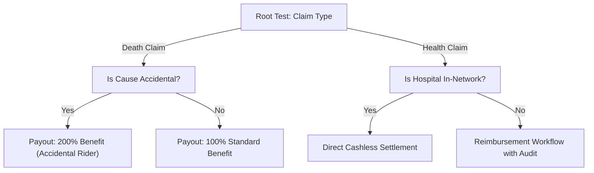
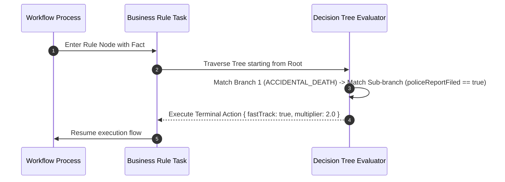

# Decision Trees (`decisionTrees`)

**Asset Key**: `decisionTrees` · **Name field**: `name` · **Exports as**: `.gdt` (Guided Decision Tree XML) · **Used by**: [Business Rule](../nodes/rule.md)'s `ruleFlowGroup`

---

## 1. Overview & Purpose

A **Decision Tree Asset** structures conditional logic into an intuitive hierarchical tree. Unlike flat decision tables, decision trees excel at deeply nested multi-stage branching decisions where later conditions are only relevant if preceding conditions evaluate to true.



---

## 2. Tree Node Structure

Each node in a decision tree is either a **Decision Split** or a **Terminal Leaf Action**:

```json
{
  "name": "ClaimTriageTree",
  "package": "com.prudential.claims.trees",
  "fact": "Claim",
  "tree": {
    "field": "claimType",
    "branches": [
      {
        "value": "ACCIDENTAL_DEATH",
        "node": {
          "field": "policeReportFiled",
          "branches": [
            { "value": true, "action": { "fastTrack": true, "multiplier": 2.0 } },
            { "value": false, "action": { "fastTrack": false, "requireInvestigation": true } }
          ]
        }
      },
      {
        "value": "CRITICAL_ILLNESS",
        "action": { "medicalReviewRequired": true }
      }
    ]
  }
}
```

---

## 3. Wiring to a Process Node

1. Select a **Business Rule** node in the Process Canvas.
2. Set **Rule Flow Group** to the decision tree's configured group name (e.g., `claim-triage-tree`).
3. Ensure the target Fact instance is in working memory before executing the rule node.



---

## 4. Production Enterprise Example

```json
{
  "name": "PolicyExclusionTree",
  "package": "com.prudential.claims.trees",
  "fact": "Claim",
  "tree": {
    "field": "policyAgeInMonths",
    "branches": [
      {
        "operator": "lessThan",
        "value": 24,
        "node": {
          "field": "preExistingCondition",
          "branches": [
            { "value": true, "action": { "eligible": false, "denialReason": "CONTESTABILITY_PERIOD_EXCLUSION" } },
            { "value": false, "action": { "eligible": true, "standardAdjudication": true } }
          ]
        }
      },
      {
        "operator": "greaterThanOrEqualTo",
        "value": 24,
        "action": { "eligible": true, "incontestable": true }
      }
    ]
  }
}
```

---

## 5. Testing & Simulation

1. Open **Project Assets** $\to$ select `PolicyExclusionTree`.
2. Select **Test & Simulate**.
3. Supply input fact data:
   ```json
   { "policyAgeInMonths": 14, "preExistingCondition": true }
   ```
4. Verify execution traverses Branch 1 $\to$ Sub-branch 1 and returns:
   ```json
   { "eligible": false, "denialReason": "CONTESTABILITY_PERIOD_EXCLUSION" }
   ```
