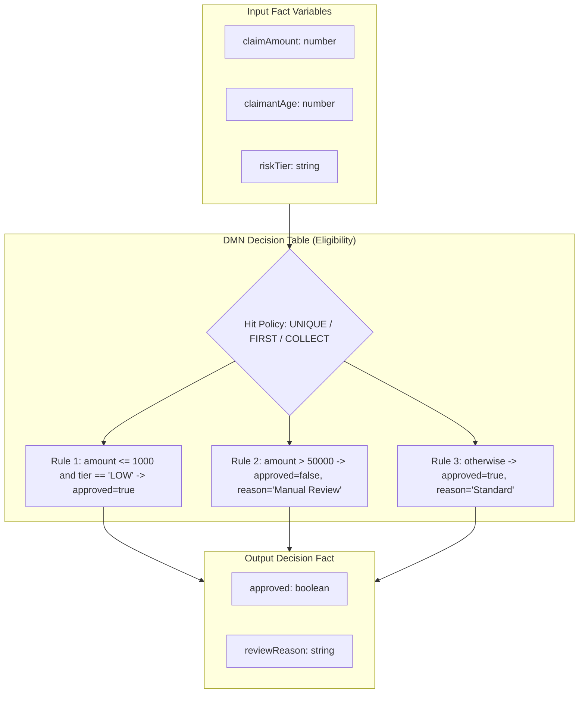
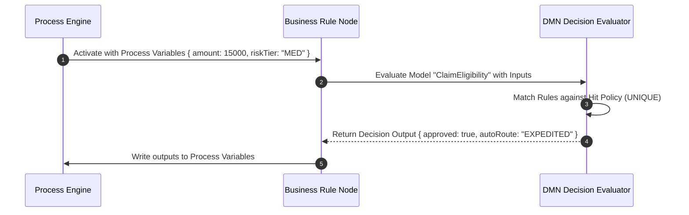

# DMN Decisions (`decisions`)

**Asset Key**: `decisions` · **Name field**: `name` · **Exports as**: `.dmn` (DMN 1.2 XML) · **Used by**: [Business Rule](../nodes/rule.md)'s `dmn.model`

---

## 1. Overview & Purpose

**DMN Decisions** author industry-standard Decision Model and Notation (DMN 1.2) decision tables without requiring manual XML authoring or raw FEEL expression parsing. 

At design time, business users and rule authors define input columns, output columns, hit policies, and declarative condition cells. At runtime or export, the system synthesizes compliant DMN 1.2 XML that evaluates directly in the engine's built-in decision table executor or exports for standard DMN interoperability.



---

## 2. Hit Policies

| Hit Policy | Meaning | Output Resolution |
|---|---|---|
| `UNIQUE` | Exactly one rule may match. Multiple matches trigger an evaluation error. | Single output row. |
| `FIRST` | Rules evaluate in top-to-bottom order; the first matching rule fires. | First matching output row. |
| `ANY` | Multiple rules may match, but all matching rules must yield identical outputs. | The shared output row. |
| `PRIORITY` | Matches evaluate against defined output order priorities. | Highest priority output. |
| `COLLECT` | All matching rules fire. Outputs can be aggregated (`SUM`, `MIN`, `MAX`, `COUNT`, `LIST`). | Aggregated value or list of output entries. |

---

## 3. Input Test Syntax (FEEL Sugar)

The decision table cell syntax provides expressive operators without writing raw FEEL:

| Test Format | Example | Matches When |
|---|---|---|
| Literal | `"TIER_1"`, `500`, `true` | Value exactly equals the literal |
| Wildcard | `"-"` | Any value (wildcard / don't care) |
| Comparison | `{"gt": 1000}`, `{"lte": 50}` | Greater than 1000 / Less than or equal to 50 |
| Interval Range | `{"between": [18, 65]}` | Value is $\ge 18$ and $\le 65$ |
| Set Membership | `{"in": ["GOLD", "PLATINUM"]}` | Value matches any item in the list |
| Negation | `{"not": "FRAUD_SUSPECT"}` | Value is not equal to target |
| FEEL Escape Hatch | `{"feel": "contains(notes, 'urgent')"}` | Raw FEEL evaluation expression |

---

## 4. Wiring to a Business Rule Node

1. In the **Process Canvas**, select or double-click a **Business Rule** node (`rule`).
2. Set **Rule Engine** to `dmn`.
3. In **DMN Model**, select your decision asset (e.g., `ClaimEligibility`).
4. Set **DMN Namespace** to the asset's namespace (e.g., `https://prudential.com/claims/eligibility`).
5. Set **Decision Name** to the target decision name, or leave blank to evaluate the primary decision.



---

## 5. Production Enterprise Example

```json
{
  "name": "AutoAdjudicationDMN",
  "namespace": "https://prudential.com/claims/adjudication",
  "decisions": [
    {
      "name": "AutoAdjudication",
      "hitPolicy": "FIRST",
      "inputs": [
        { "name": "claimAmount", "type": "number" },
        { "name": "policyYears", "type": "number" },
        { "name": "priorDisputes", "type": "boolean" }
      ],
      "outputs": [
        { "name": "autoApproved", "type": "boolean" },
        { "name": "routeQueue", "type": "string" },
        { "name": "auditSeverity", "type": "string" }
      ],
      "rules": [
        {
          "when": { "priorDisputes": true },
          "then": { "autoApproved": false, "routeQueue": "INVESTIGATION", "auditSeverity": "HIGH" }
        },
        {
          "when": { "claimAmount": { "lte": 5000 }, "policyYears": { "gte": 2 } },
          "then": { "autoApproved": true, "routeQueue": "FAST_TRACK_PAYOUT", "auditSeverity": "LOW" }
        },
        {
          "when": { "claimAmount": { "gt": 5000 } },
          "then": { "autoApproved": false, "routeQueue": "SENIOR_ADJUDICATOR", "auditSeverity": "MEDIUM" }
        },
        {
          "when": { "claimAmount": "-" },
          "then": { "autoApproved": false, "routeQueue": "MANUAL_TRIAGE", "auditSeverity": "STANDARD" }
        }
      ]
    }
  ]
}
```

---

## 6. Testing & Simulation

1. Navigate to **Project Assets** $\to$ select `AutoAdjudicationDMN`.
2. Open the **Test & Simulate** tab.
3. Supply test scenario variables:
   ```json
   { "claimAmount": 3200, "policyYears": 4, "priorDisputes": false }
   ```
4. Click **Run Test Simulation** to verify the firing rule and output payload (`autoApproved = true`, `routeQueue = "FAST_TRACK_PAYOUT"`).
