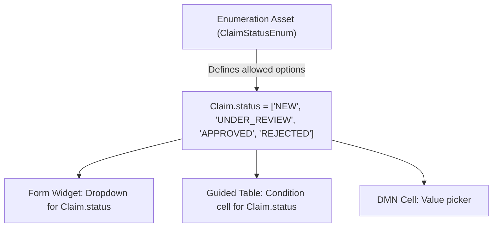
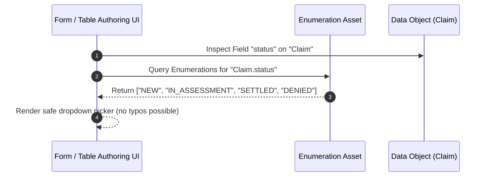

# Enumerations (`enumerations`)

**Asset Key**: `enumerations` · **Name field**: `name` · **Exports as**: `.enumeration` (KIE Data Enumeration) · **Used by**: Data Type fields, Form dropdowns, Guided Tables

---

## 1. Overview & Purpose

An **Enumeration Asset** defines fixed lists of valid options for specific Data Type fields (e.g. `Claim.status`, `Payment.currency`, `Coverage.type`). 

Instead of hardcoding allowed strings across multiple UI forms and decision tables, an enumeration centrally defines the allowed options for `Fact.field`. When authoring forms or rule condition cells targeting that field, the editor automatically renders a structured dropdown selector populated with the enumeration's values.



---

## 2. Model Structure & Schema

```json
{
  "name": "ClaimEnums",
  "enums": {
    "Claim.status": ["NEW", "IN_ASSESSMENT", "PENDING_DOCUMENTS", "SETTLED", "DENIED"],
    "Claim.disbursementMethod": ["ELECTRONIC_TRANSFER", "CHECK", "ESCROW"]
  }
}
```

### Syntax Format in `.enumeration` File

```properties
'Claim.status' : ['NEW=New Submission', 'IN_ASSESSMENT=Under Assessment', 'SETTLED=Settled and Paid', 'DENIED=Denied']
'Claim.priority' : ['LOW', 'MEDIUM', 'HIGH', 'CRITICAL']
```

---

## 3. Wiring to Forms & Decision Tables

1. **Data Object Fields**: When a Data Type field matches the pattern `FactName.fieldName`, any form control or table column bound to that field automatically detects the enumeration and renders a dropdown.
2. **Form Builder**: When configuring a Form field, pointing its `bind` to `status` on a `Claim` task input causes the Task Detail UI to render the human-readable option labels.
3. **Guided Decision Tables**: When adding a condition column for `Claim.status`, the table editor restricts cell input to the enumeration's items.



---

## 4. Production Enterprise Example

```json
{
  "name": "InsuranceDomainEnums",
  "enums": {
    "Policy.lineOfBusiness": [
      "TERM_LIFE=Individual Term Life",
      "WHOLE_LIFE=Permanent Whole Life",
      "CRITICAL_ILLNESS=Critical Illness Rider",
      "ACCIDENTAL_DISABILITY=Accidental Total Disability"
    ],
    "Claim.denialCode": [
      "ERR_POLICY_LAPSED=Policy Lapsed Due to Non-payment",
      "ERR_PRE_EXISTING=Pre-existing Condition Unreported",
      "ERR_EXCLUDED_PERIL=Peril Excluded by Policy Clause",
      "ERR_FRAUDULENT=Fraudulent Documentation Identified"
    ],
    "Payment.currency": ["USD", "SGD", "GBP", "EUR", "INR"]
  }
}
```

---

## 5. Operational Gotchas & Edge Cases

- **Exact Case Sensitivity**: The fact name and field name in the enum key must match the Data Type definition exactly (e.g., `Claim.status`, not `claim.Status`).
- **Renaming Data Type Fields**: If a Data Type field is renamed from `status` to `currentStatus`, update the enumeration key accordingly so UI binding continues to resolve.
