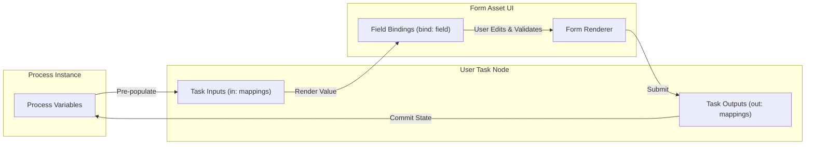
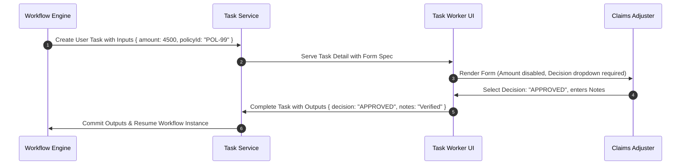

# Forms (`forms`)

**Asset Key**: `forms` · **Name field**: `name` · **Exports as**: `.form` / `.frm` · **Used by**: [User Task](../nodes/user-task.md)'s `form` field

---

## 1. Overview & Purpose

A **Form Asset** provides the interactive data-entry interface for human users completing workflow tasks in the Task Detail Work tab. Instead of editing raw JSON, users interact with typed inputs, dropdowns, radio groups, date pickers, and checkboxes with client-side validation rules.

Forms bind directly to task inputs (pre-populating read-only or editable values from process state) and task outputs (writing validated user submissions back into process variables).



---

## 2. Model Structure & Schema

```json
{
  "name": "ClaimApprovalForm",
  "model": { "className": "com.prudential.claims.ClaimApprovalForm" },
  "fields": [
    {
      "bind": "amount",
      "label": "Claim Amount",
      "widget": "decimal",
      "readOnly": true
    }
  ]
}
```

### Supported Field Properties

| Property | Type | Description |
|---|---|---|
| `bind` | `string` | The task input/output field name this control binds to. Must match User Task data mappings. |
| `label` | `string` | Human-readable label displayed next to or above the input widget. |
| `widget` | `string` | Input widget type: `text`, `textarea`, `integer`, `number`, `decimal`, `checkbox`, `boolean`, `dropdown`, `select`, `radio`, `date`. |
| `required` | `boolean` | When `true`, prevents task completion until a valid non-empty value is supplied. |
| `readOnly` | `boolean` | When `true`, displays the value as non-editable text or disabled control. |
| `placeholder` | `string` | Hint text displayed inside empty inputs. |
| `options` | `string[]` | Static option list for `dropdown`, `select`, or `radio` widgets. |
| `defaultValue` | `any` | Default initial value if task input does not provide one. |

---

## 3. Wiring to a Process Node

1. Open your process in the **Process Canvas**.
2. Select or double-click the target **User Task** node.
3. In the properties panel:
   - Set **Form** to the name of this form (e.g., `ClaimApprovalForm`).
   - In **Task Inputs**, map process variables to the form's `bind` keys (e.g., `processVar.claimAmount` $\to$ `amount`).
   - In **Task Outputs**, map form input submissions back to process variables (e.g., `decision` $\to$ `processVar.approvalStatus`).



---

## 4. Production Enterprise Example

```json
{
  "name": "ClaimAssessmentForm",
  "model": { "className": "com.prudential.claims.AssessmentForm" },
  "fields": [
    { "bind": "claimId", "label": "Claim Reference ID", "widget": "text", "readOnly": true },
    { "bind": "policyNumber", "label": "Policy Number", "widget": "text", "readOnly": true },
    { "bind": "claimAmount", "label": "Claimed Amount ($)", "widget": "decimal", "readOnly": true },
    { "bind": "riskScore", "label": "Automated Risk Score", "widget": "integer", "readOnly": true },
    { "bind": "decision", "label": "Adjuster Assessment", "widget": "select", "required": true, "options": ["APPROVE", "REJECT", "REQUEST_MORE_INFO"] },
    { "bind": "payoutAmount", "label": "Settlement Amount ($)", "widget": "decimal", "placeholder": "Enter approved payout amount" },
    { "bind": "assessmentNotes", "label": "Underwriter Notes & Justification", "widget": "textarea", "required": true, "placeholder": "Document justification for audit trail" }
  ]
}
```

---

## 5. Testing & Verification

1. Open **Project Assets** $\to$ click `ClaimAssessmentForm`.
2. Click the **Test & Simulate** tab.
3. Provide mock task input data:
   ```json
   { "claimId": "CLM-1004", "policyNumber": "POL-882", "claimAmount": 12500.00, "riskScore": 42 }
   ```
4. Verify that fields render accurately with default bindings and validation states.
5. In process integration tests, verify that `outputs` emitted by completing the human task conform to the expected schema.

---

## 6. Operational Gotchas & Edge Cases

- **Renaming Forms**: Renaming a form asset does not automatically update referencing User Task nodes. Check the **Referenced by** panel on the asset detail dialog before renaming.
- **Enumeration Binding**: When using standardized domain enumerations (e.g., `ClaimStatus`), tie the form's `bind` field to the underlying Data Type field rather than hardcoding string options.
- **Field Keys Collision**: Do not define two fields with the same `bind` name in the same form asset; the second control will overwrite the first submission value.
