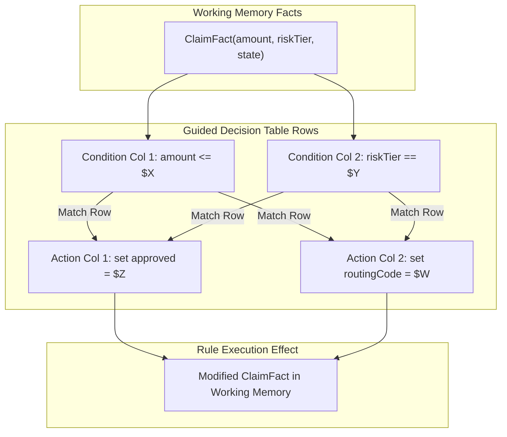
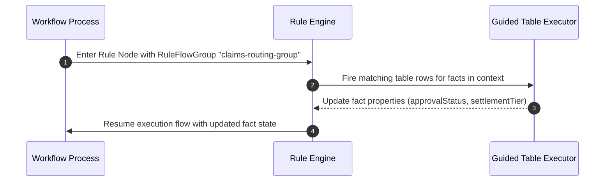

# Guided Decision Tables (`guidedTables`)

**Asset Key**: `guidedTables` · **Name field**: `name` · **Exports as**: `.gdst` (Guided Decision Table XML) · **Used by**: [Business Rule](../nodes/rule.md)'s `ruleFlowGroup`

---

## 1. Overview & Purpose

A **Guided Decision Table** allows business analysts and rule designers to author complex table-based business rules targeting specific **Fact Types** (Data Objects). Each column defines either a pattern condition (`when`) on fact fields or an action consequence (`then`) modifying or setting fact attributes.

On export or execution, the engine translates the table rows into standard Drools production rules (`.drl`) grouped under the specified `ruleFlowGroup`.



---

## 2. Table Column Types

| Column Category | Role | Description |
|---|---|---|
| `CONDITION` | Pattern Matching | Evaluates a boolean constraint against a fact property (e.g. `amount <= 5000`). |
| `ACTION_SET_FIELD` | Fact Mutation | Updates an existing fact attribute in working memory. |
| `ACTION_INSERT_FACT` | Fact Creation | Inserts a brand new fact instance into working memory upon match. |
| `METADATA` | Rule Attributes | Configures rule metadata such as `salience` (priority), `no-loop`, or `enabled`. |

---

## 3. Wiring to a Process Node

1. In the **Process Canvas**, select a **Business Rule** node (`rule`).
2. Set **Rule Engine** to `drl` or `guided`.
3. Set **Rule Flow Group** to the table's configured rule flow group name (e.g., `claims-routing-group`).
4. In process variables, ensure the target Fact object is loaded or mapped into the execution context.



---

## 4. Production Enterprise Example

```json
{
  "name": "ClaimTieringTable",
  "package": "com.prudential.claims.rules",
  "fact": "Claim",
  "ruleFlowGroup": "claim-tiering",
  "columns": [
    { "type": "condition", "field": "claimAmount", "operator": "lessThanOrEqualTo", "header": "Max Amount" },
    { "type": "condition", "field": "policyTenureYears", "operator": "greaterThan", "header": "Min Tenure" },
    { "type": "action", "field": "serviceTier", "header": "Assigned Service Tier" },
    { "type": "action", "field": "requiresInspection", "header": "Requires Onsite Inspection" }
  ],
  "rows": [
    [1000, 1, "TIER_BRONZE", false],
    [5000, 3, "TIER_SILVER", false],
    [25000, 5, "TIER_GOLD", true],
    [100000, 10, "TIER_PLATINUM", true]
  ]
}
```

---

## 5. Testing & Simulation

1. Open **Project Assets** $\to$ select `ClaimTieringTable`.
2. Select **Test & Simulate**.
3. Supply a test Fact payload:
   ```json
   { "claimAmount": 4200, "policyTenureYears": 4 }
   ```
4. Verify that Row 2 matches, resulting in:
   ```json
   { "serviceTier": "TIER_SILVER", "requiresInspection": false }
   ```
