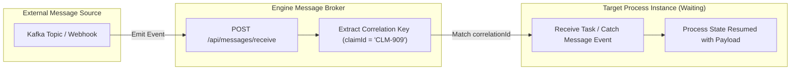
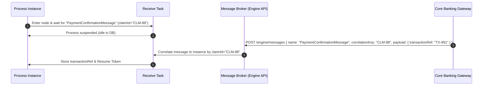

# Messages (`messages`)

**Asset Key**: `messages` · **Name field**: `name` · **Exports as**: `.wid` / BPMN 2.0 `<bpmn2:message>` · **Used by**: Send, Receive, Catch Event, Throw Event, Boundary Event

---

## 1. Overview & Purpose

A **Message Definition Asset** defines the asynchronous event contract between external systems (Kafka, RabbitMQ, Webhooks) and workflow process instances. 

It defines the payload data structure, message channel name, and **Correlation Key** used to route incoming asynchronous messages directly to the waiting process instance.



---

## 2. Model Structure & Schema

```json
{
  "name": "PaymentConfirmationMessage",
  "dataType": "com.prudential.claims.model.PaymentReceipt",
  "correlationKey": "claimId",
  "description": "Triggered when external payment gateway successfully settles claim disbursement",
  "fields": [
    { "name": "claimId", "type": "string", "required": true },
    { "name": "transactionRef", "type": "string", "required": true },
    { "name": "settledAmount", "type": "number", "required": true },
    { "name": "settlementTimestamp", "type": "date", "required": true }
  ]
}
```

---

## 3. Wiring to Process Nodes

| Node Type | How it Uses This Message Asset |
|---|---|
| **Start Message Event** | Instantiates a brand new process when this message arrives. |
| **Receive Task / Intermediate Catch** | Suspends instance execution until a message with matching `correlationKey` arrives. |
| **Throw Message Event / Send Task** | Emits this message to external message broker or another waiting process. |
| **Boundary Message Event** | Interrupts or triggers concurrent handling on a task when an unexpected message arrives. |



---

## 4. Production Enterprise Example

```json
{
  "name": "MedicalDocumentReceivedMessage",
  "dataType": "com.prudential.claims.model.DocumentEnvelope",
  "correlationKey": "caseId",
  "description": "Dispatched by document management system when claimant uploads pending medical evidence",
  "fields": [
    { "name": "caseId", "type": "string", "required": true },
    { "name": "documentType", "type": "string", "required": true },
    { "name": "documentS3Uri", "type": "string", "required": true },
    { "name": "uploadTimestamp", "type": "date", "required": true }
  ]
}
```

---

## 5. Operational Gotchas & Edge Cases

- **Missing Correlation Key**: If an incoming message does not supply the configured `correlationKey`, the message cannot be delivered to an active instance and will be rejected with `UNMATCHED_CORRELATION`.
- **Instance Not Waiting**: If a message arrives before the target process has entered the Receive or Catch node, ensure intermediate message buffering or event sub-process buffering is enabled.
