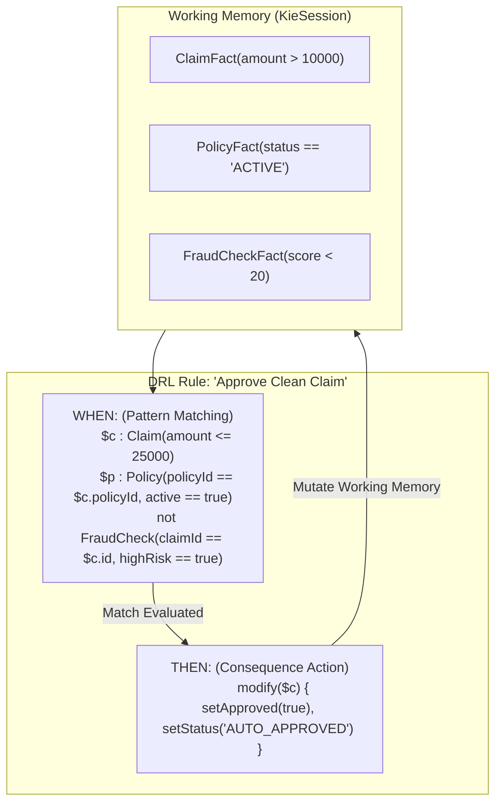
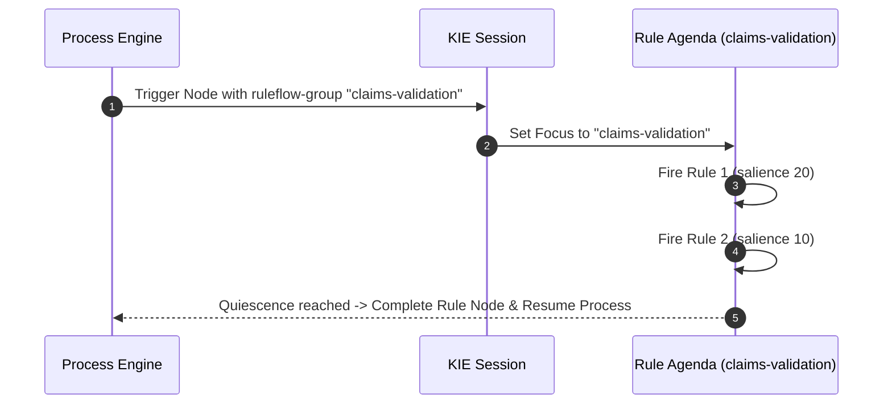

# DRL Rulesets (`rulesets`)

**Asset Key**: `rulesets` · **Name field**: `name` · **Exports as**: `.drl` (Drools Rule Language) · **Used by**: [Business Rule](../nodes/rule.md)'s `ruleFlowGroup`

---

## 1. Overview & Purpose

A **DRL Ruleset Asset** contains production rules authored in Drools Rule Language (DRL). It provides maximum expressiveness for declarative rule authoring, allowing working memory pattern matching, complex joins across multiple facts, accumulator expressions, and consequence actions.

Rules are organized under a package, declare imports and globals, and group into **Rule Flow Groups** or **Agenda Groups** activated by workflow process nodes.



---

## 2. Structure & Syntax

```drl
package com.prudential.claims.rules;

import com.prudential.claims.model.Claim;
import com.prudential.claims.model.Policy;
global org.slf4j.Logger logger;

rule "Fast Track Approval"
    ruleflow-group "claims-validation"
    salience 10
    no-loop true
    when
        $claim : Claim( amount < 5000, status == "SUBMITTED" )
        $policy : Policy( policyNumber == $claim.policyNumber, status == "ACTIVE" )
    then
        $claim.setStatus("APPROVED");
        $claim.setApprovalNotes("Auto-approved via Fast Track ruleset");
        update($claim);
end
```

### Key DRL Attributes

| Attribute | Type | Purpose |
|---|---|---|
| `ruleflow-group` | `string` | Associates the rule with a specific workflow Business Rule node. |
| `salience` | `integer` | Execution priority. Higher integer salience rules fire before lower salience rules. |
| `no-loop` | `boolean` | Prevents the rule from reactivating itself if its own RHS mutates facts it matched on. |
| `lock-on-active` | `boolean` | Ensures rules in the agenda group fire at most once during activation. |
| `agenda-group` | `string` | Groups rules for programmatic activation via KIE session. |

---

## 3. Wiring to a Process Node

1. In the Process Canvas, select a **Business Rule** node (`rule`).
2. Set **Rule Engine** to `drl`.
3. In **Rule Flow Group**, enter the exact `ruleflow-group` specified in the DRL file (e.g. `claims-validation`).
4. When the process execution token reaches this node, the engine activates that rule flow group, evaluates all matching rules, and proceeds once rule firing quiesces.



---

## 4. Production Enterprise Example

```json
{
  "name": "DeathClaimAdjudicationRules",
  "package": "com.prudential.claims.rules",
  "imports": [
    "com.prudential.claims.model.DeathClaimCase",
    "com.prudential.claims.model.ClaimVerificationResult"
  ],
  "rules": [
    {
      "name": "Verify Contestability Period",
      "ruleFlowGroup": "death-claim-triage",
      "salience": 100,
      "when": "$c : DeathClaimCase( contestabilityFlag == true, baseBenefitAmount > 20000 )",
      "then": "$c.setCurrentStatus('MANDATORY_UNDERWRITER_REVIEW'); update($c);"
    },
    {
      "name": "Apply Accidental Death Rider",
      "ruleFlowGroup": "death-claim-triage",
      "salience": 50,
      "when": "$c : DeathClaimCase( causeOfDeath == 'ACCIDENT', accidentalDeathBenefit > 0 )",
      "then": "$c.setBaseBenefitAmount($c.getBaseBenefitAmount() + $c.getAccidentalDeathBenefit()); update($c);"
    }
  ]
}
```

---

## 5. Testing & Verification

1. Open **Project Assets** $\to$ click `DeathClaimAdjudicationRules`.
2. Open the **Test & Simulate** tab.
3. Supply input facts:
   ```json
   { "causeOfDeath": "ACCIDENT", "baseBenefitAmount": 50000, "accidentalDeathBenefit": 50000 }
   ```
4. Click **Execute Rules** to observe fact mutations and verification output:
   `baseBenefitAmount` updated to `100000`.
