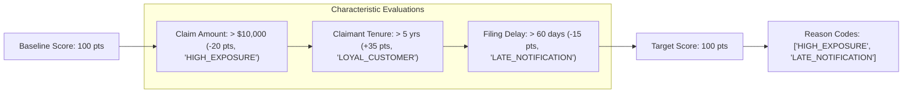
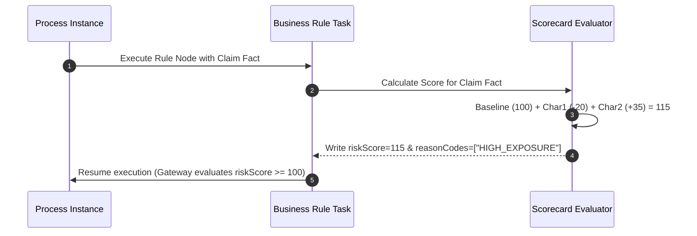

# Scorecards (`scorecards`)

**Asset Key**: `scorecards` · **Name field**: `name` · **Exports as**: `.scgd` (Scorecard XML) · **Used by**: [Business Rule](../nodes/rule.md)'s `ruleFlowGroup`

---

## 1. Overview & Purpose

A **Scorecard Asset** implements additive multi-characteristic risk scoring models (such as credit underwriting, fraud detection, and claim complexity evaluation). 

Starting from an initial **Baseline Score**, the scorecard evaluates a series of independent **Characteristics** (e.g. claimant history, claim amount, documentation completeness). Each matching attribute adds or subtracts points from the total score and can contribute an audit **Reason Code**.



---

## 2. Model Structure & Scoring Algorithms

```json
{
  "name": "ClaimRiskScorecard",
  "package": "com.prudential.claims.scoring",
  "fact": "Claim",
  "target": "riskScore",
  "baseline": 100,
  "scoringStrategy": "WEIGHTED_ADDITIVE",
  "characteristics": [
    {
      "name": "Claimant History",
      "field": "priorClaimsCount",
      "attributes": [
        { "condition": "== 0", "score": 30, "reasonCode": "CLEAN_RECORD" },
        { "condition": "between 1 and 2", "score": 0, "reasonCode": "STANDARD_HISTORY" },
        { "condition": "> 2", "score": -40, "reasonCode": "REPEATED_CLAIMANT" }
      ]
    }
  ]
}
```

### Scoring Strategies

| Strategy | Description |
|---|---|
| `WEIGHTED_ADDITIVE` | Final score = Baseline + Sum of all characteristic points. |
| `MAXIMUM_POINTS` | Final score determined by the single highest matching characteristic. |
| `MINIMUM_POINTS` | Final score determined by the single lowest matching characteristic. |

---

## 3. Wiring to a Process Node

1. Select a **Business Rule** node in the Process Canvas.
2. Set **Rule Engine** to `drl` or `scorecard`.
3. Set **Rule Flow Group** to the scorecard's configured group (e.g. `claim-risk-scoring`).
4. The rule engine calculates the score and writes the total into the fact's `target` property (e.g., `claim.riskScore`).



---

## 4. Production Enterprise Example

```json
{
  "name": "FraudRiskScorecard",
  "package": "com.prudential.claims.scoring",
  "fact": "Claim",
  "target": "fraudIndex",
  "baseline": 50,
  "scoringStrategy": "WEIGHTED_ADDITIVE",
  "characteristics": [
    {
      "name": "Discrepancy In Bill Amount",
      "field": "billedVsEstimatedRatio",
      "attributes": [
        { "condition": "<= 1.1", "score": 0, "reasonCode": "NORMAL_BILLING" },
        { "condition": "between 1.1 and 1.5", "score": 25, "reasonCode": "MODERATE_DISCREPANCY" },
        { "condition": "> 1.5", "score": 60, "reasonCode": "SEVERE_OVERBILLING" }
      ]
    },
    {
      "name": "Hospital Network Status",
      "field": "inNetworkHospital",
      "attributes": [
        { "condition": "true", "score": -10, "reasonCode": "PREFERRED_PROVIDER" },
        { "condition": "false", "score": 20, "reasonCode": "OUT_OF_NETWORK" }
      ]
    }
  ]
}
```

---

## 5. Testing & Simulation

1. Open **Project Assets** $\to$ select `FraudRiskScorecard`.
2. Open **Test & Simulate**.
3. Supply input fact data:
   ```json
   { "billedVsEstimatedRatio": 1.65, "inNetworkHospital": false }
   ```
4. Verify the simulation yields:
   - Base (50) + Discrepancy (60) + Out of network (20) = **130**
   - Reason Codes: `["SEVERE_OVERBILLING", "OUT_OF_NETWORK"]`
