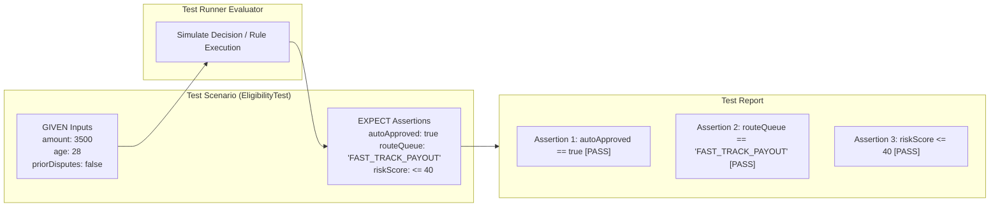
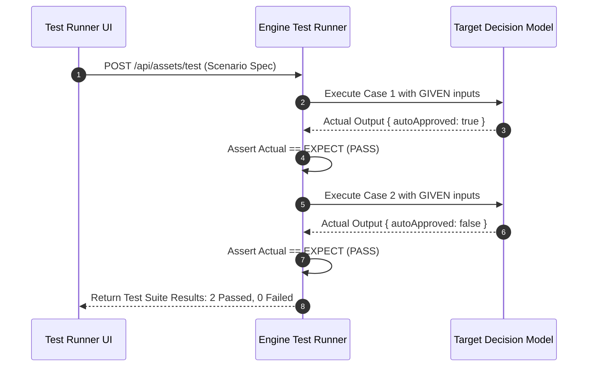

# Test Scenarios (`tests`)

**Asset Key**: `tests` · **Name field**: `name` · **Exports as**: `.scesim` (Scenario Simulation XML) · **Used by**: Automated Unit & Regression Test Runners

---

## 1. Overview & Purpose

A **Test Scenario Asset** defines automated unit and regression test specifications for decision tables, DRL rulesets, scorecards, and process data flows. 

Each scenario defines a set of **GIVEN** inputs (initial facts and variables) and asserts **EXPECT** outputs (expected mutations, fired rules, or output values). Running the test scenario verifies business logic correctness without deploying the project to a live runtime environment.



---

## 2. Model Structure & Schema

```json
{
  "name": "ClaimAdjudicationTests",
  "target": "AutoAdjudicationDMN",
  "targetKind": "decisions",
  "description": "Validates boundary edge cases for claims auto-approval",
  "scenarios": [
    {
      "name": "Standard Low Risk Claim Approves",
      "given": {
        "claimAmount": 2500,
        "policyYears": 3,
        "priorDisputes": false
      },
      "expect": {
        "autoApproved": true,
        "routeQueue": "FAST_TRACK_PAYOUT"
      }
    },
    {
      "name": "High Exposure Claim Routes To Senior",
      "given": {
        "claimAmount": 15000,
        "policyYears": 1,
        "priorDisputes": false
      },
      "expect": {
        "autoApproved": false,
        "routeQueue": "SENIOR_ADJUDICATOR"
      }
    }
  ]
}
```

---

## 3. Running Scenarios in the Platform

1. In **Project Assets**, click the Test Scenario asset.
2. Select the **Test & Simulate** tab.
3. Click **Run All Scenarios**.
4. The test runner executes all test cases against the live target model in milliseconds and displays green **PASS** / red **FAIL** badges with diff details for any assertion mismatches.



---

## 4. Continuous Integration & Pre-Deployment Gates

When building or publishing a project version (`POST /versions/:id/publish`), the engine automatically executes all test scenario assets. If any scenario fails an assertion, deployment is blocked, preventing broken business logic from reaching production environments.
