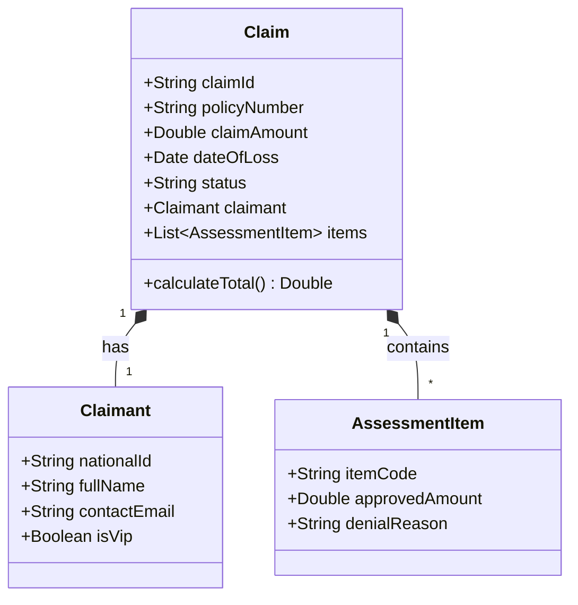
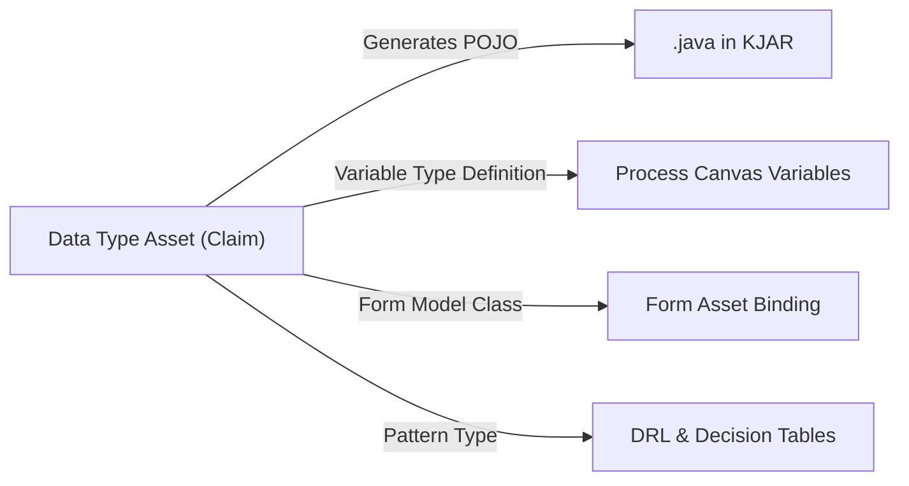

# Data Types / Data Objects (`types`)

**Asset Key**: `types` · **Name field**: `name` · **Exports as**: `.java` (Java POJO Source) · **Used by**: Process Variables (`itemSubjectRef`), Rules, Forms, Messages

---

## 1. Overview & Purpose

**Data Types** (Data Objects) represent the strongly typed domain entities in your business process project (e.g. `Claim`, `Policy`, `Claimant`, `AssessmentResult`). 

Authoring a Data Type creates a typed definition with fields, getters/setters, serializable implementations, and KIE annotations. On export, the SDK synthesizes standard Java source files (`.java`) in the project KJAR. At runtime, the workflow engine enforces schema validation on process variables typed against these definitions.



---

## 2. Model Structure & Schema

```json
{
  "name": "Claim",
  "package": "com.prudential.claims.model",
  "fields": [
    { "name": "claimId", "type": "String", "required": true },
    { "name": "claimAmount", "type": "Double", "required": true },
    { "name": "dateOfLoss", "type": "java.util.Date" },
    { "name": "status", "type": "com.prudential.claims.model.ClaimStatus" },
    { "name": "claimant", "type": "com.prudential.claims.model.Claimant" }
  ]
}
```

### Supported Field Types

| Type Identifier | Java Target Equivalent | JavaScript / JSON Runtime Representation |
|---|---|---|
| `String` | `java.lang.String` | `string` |
| `Integer` / `int` | `java.lang.Integer` | `number` (integer) |
| `Long` / `long` | `java.lang.Long` | `number` / `string` (for 64-bit precision) |
| `Double` / `decimal` | `java.lang.Double` | `number` (float) |
| `Boolean` / `bool` | `java.lang.Boolean` | `boolean` (`true` / `false`) |
| `Date` | `java.util.Date` | ISO 8601 string (`"2026-10-29T10:00:00Z"`) |
| Custom Type | e.g. `com.acme.Claimant` | nested JSON `object` |
| List / Collection | e.g. `java.util.List<Claim>` | JSON `array` `[...]` |

---

## 3. Wiring to Processes & Other Assets

1. **Process Variables**: In the Process Canvas, open **Process Variables** and specify the type name as the variable's type.
2. **User Tasks & Forms**: Forms bind their `model.className` to the Data Type FQN.
3. **Business Rules & DRL**: Rules pattern-match against the generated Java class in working memory:
   ```drl
   rule "High Value Claim"
   when
       $c : Claim( claimAmount > 50000 )
   then
       $c.setStatus("REQUIRES_VP_APPROVAL");
   end
   ```



---

## 4. Production Enterprise Example

```json
{
  "name": "DeathClaimCase",
  "package": "com.prudential.claims.model",
  "fields": [
    { "name": "caseNumber", "type": "String", "required": true },
    { "name": "policyNumber", "type": "String", "required": true },
    { "name": "insuredId", "type": "String", "required": true },
    { "name": "causeOfDeath", "type": "String" },
    { "name": "dateOfDeath", "type": "Date", "required": true },
    { "name": "baseBenefitAmount", "type": "Double", "required": true },
    { "name": "accidentalDeathBenefit", "type": "Double", "defaultValue": 0.0 },
    { "name": "contestabilityFlag", "type": "Boolean", "defaultValue": false },
    { "name": "currentStatus", "type": "String", "defaultValue": "SUBMITTED" }
  ]
}
```

---

## 5. Testing & Verification

1. In **Project Assets**, click the Data Type asset.
2. Verify that field types, nullability constraints, and default values are valid.
3. Test exporting the project (`Export KJAR`): verify that `src/main/java/com/prudential/claims/model/DeathClaimCase.java` compiles without syntax errors.
