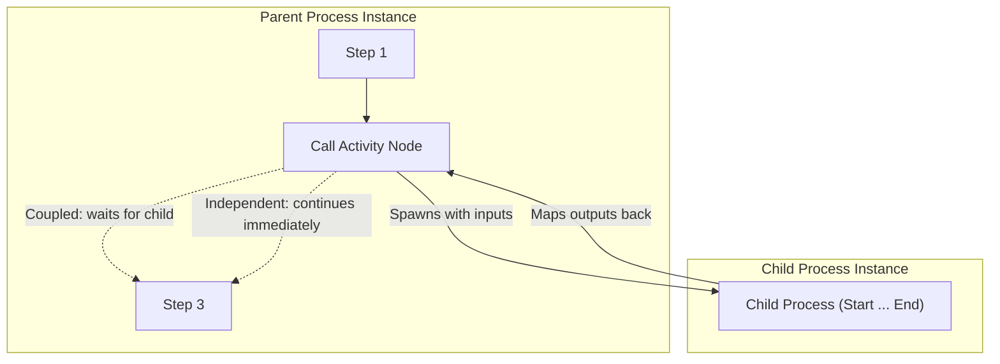

# Call Activity (`call`)

## 1. Overview & Purpose
A **Call Activity** references and executes a separate, reusable process definition as a child instance. It promotes modularity, separation of concerns, and cross-project process reuse. Call activities support bidirectional variable data mapping and lifecycle coupling.



## 2. Supported Scenarios & Behavioral Variants

### Scenario A: Coupled Child Subprocess (`independent: false` / default)
- **Behavior**: The parent execution token pauses at the Call Activity. A new child instance is created and starts running. When the child completes, its output variables are mapped back into the parent instance, and the parent token resumes.
- **Cascade Abort**: If the parent instance is aborted or cancelled by an Error Boundary or Terminate End, the child instance is automatically aborted as well.
- **When to Use**: Synchronous subprocesses whose results are required by subsequent parent steps (e.g. Identity Verification subprocess).

### Scenario B: Independent / Fire-and-Forget (`independent: true`)
- **Behavior**: The child process instance is spawned asynchronously and decoupled from the parent. The parent token continues immediately down its outgoing flow without waiting.
- **Decoupled Lifecycle**: Subsequent completion, failure, or abortion of the child has no effect on the parent, and aborting the parent does not affect the child.
- **When to Use**: Background processing pipelines, asynchronous archival tasks, and independent audit workflows.

## 3. Property Reference & Possible Values

| Field | JSON Path | Type | Allowed Values | Default | Description |
|---|---|---|---|---|---|
| **Name** | `name` | `string` | Free text | `"Call Activity"` | Label displayed on diagram. |
| **Process ID** | `process` | `string` | `workflowKey.processId` | `""` | Target process definition behind any active deployment. |
| **Inputs** | `inputs` | `Record<string, string>` | `childVar ← $parentVar` | `{}` | Variable mapping passed into the child instance. |
| **Outputs** | `outputs` | `Record<string, string>` | `parentVar ← childVar` | `{}` | Variable mapping returned to the parent upon completion. |
| **Independent** | `independent` | `boolean` | `true`, `false` | `false` | Fire-and-forget toggle. |

## 4. When to Use & When NOT to Use
- **Do Use**:
  - Encapsulate complex sub-workflows (e.g. KYC, Fraud Scoring, Underwriting) into independent, versionable definitions.
  - Cross-project invocation: Call processes deployed by other teams in the same tenant.
- **Do NOT Use**:
  - Do NOT use for small, trivial 1-step scripts (use Script Task).
  - Do NOT create recursive Call Activities without termination guards.

## 5. Concrete Step-by-Step Examples

### Example 1: Synchronous KYC Subprocess with Data Mapping
```json
{
  "id": "call_kyc",
  "name": "Verify Identity",
  "type": "call",
  "process": "compliance-wf.kyc_verification_process",
  "independent": false,
  "inputs": {
    "customerId": "$customerId",
    "countryCode": "$country"
  },
  "outputs": {
    "kycApproved": "verified",
    "kycRiskScore": "riskLevel"
  }
}
```

### Example 2: Fire-and-Forget Notification Pipeline
```json
{
  "id": "call_notify_async",
  "name": "Trigger Async Notifications",
  "type": "call",
  "process": "notifications.send_omnichannel_alerts",
  "independent": true,
  "inputs": {
    "claimRef": "$claimNumber"
  }
}
```

## 6. Testing Scenarios & Verification Guide
1. **Coupled Execution**: Parent calls child; verify child reaches complete; parent resumes and receives mapped output variables.
2. **Cascade Abort**: Abort parent while child is waiting on a human task; verify child instance transitions to `aborted`.
3. **Independent Lifecycle**: Parent calls independent child; parent completes immediately; verify child continues running.
