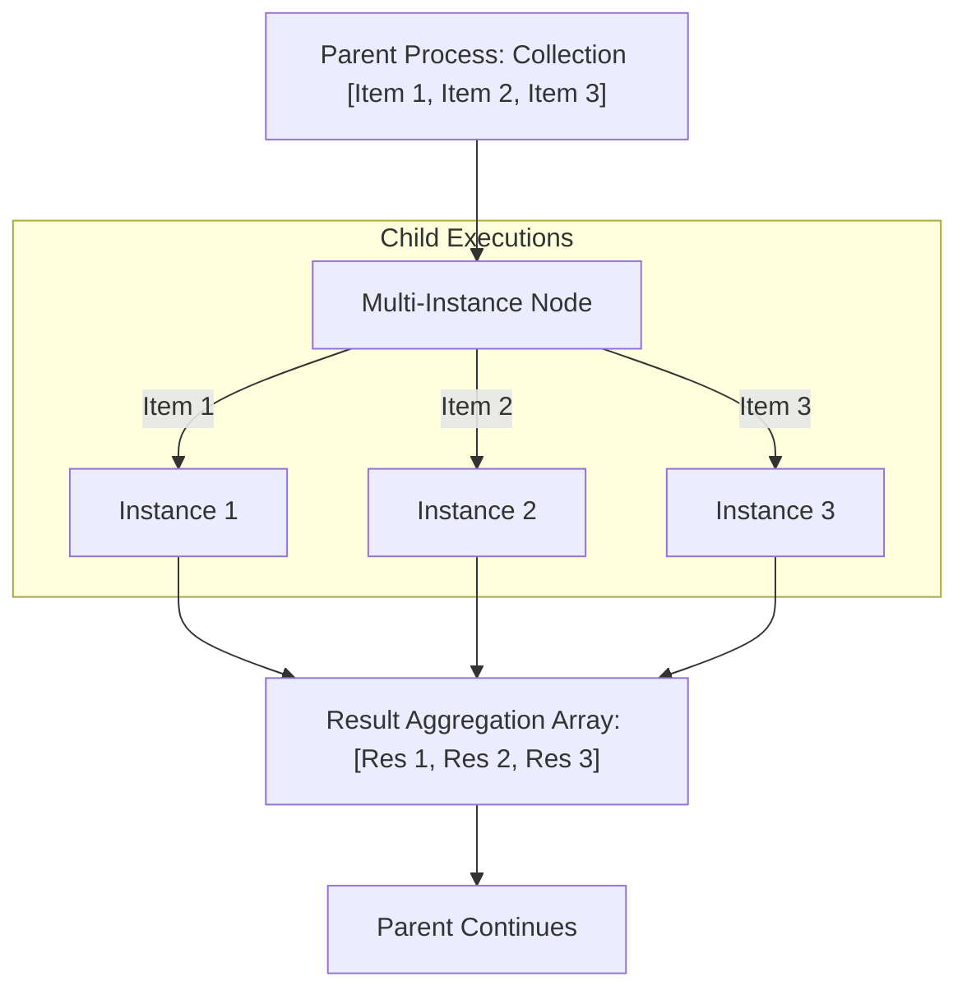

# Multi-Instance Activity (`forEach`)

## 1. Overview & Purpose
The **Multi-Instance Activity** iterates over an array collection variable and executes a target child process definition once for every item in the collection. It supports both **Parallel** (all items execute concurrently) and **Sequential** (one after another) execution modes, with automatic result aggregation.



## 2. Supported Scenarios & Behavioral Variants

### Scenario A: Parallel Multi-Instance (`parallel: true`)
- **Behavior**: Spawns concurrent child process instances for every element in the collection simultaneously.
- **Synchronization**: The parent token waits until **every child instance completes**.
- **When to Use**: High-throughput parallel operations (e.g. validating 5 medical documents concurrently, checking credit with 3 bureaus simultaneously).

### Scenario B: Sequential Multi-Instance (`parallel: false`)
- **Behavior**: Iterates over items in array index order. Item $N+1$ begins only after Item $N$ has fully reached completion.
- **When to Use**: Dependent step sequences (e.g. tiered approval chain where step 2 is only requested if step 1 passes).

### Scenario C: Collection Result Aggregation (`collectInto`, `itemResult`)
- **Behavior**: Once all children finish, extracts `itemResult` from each child in order and writes the aggregated array into the parent variable `collectInto`.
- **When to Use**: Aggregating per-item decisions, scores, or processed payloads back into a single report.

## 3. Property Reference & Possible Values

| Field | JSON Path | Type | Allowed Values | Default | Description |
|---|---|---|---|---|---|
| **Name** | `name` | `string` | Free text | `"Multi-instance"` | Label. |
| **Process** | `process` | `string` | `workflowKey.processId` | `""` | Target process definition executed for each element. |
| **Collection** | `over` | `string` | Variable name (array) | `"items"` | Parent variable holding the array to iterate. |
| **Item Variable** | `as` | `string` | Variable name | `"item"` | Variable name injected into the child containing the current item. |
| **Collect Into** | `collectInto` | `string` | Variable name | `undefined` | Parent array variable to store gathered results. |
| **Item Result** | `itemResult` | `string` | Variable name | `undefined` | Child variable to extract into the aggregated array. |
| **Parallel** | `parallel` | `boolean` | `true`, `false` | `false` | Run concurrently (true) or sequentially (false). |
| **Pass-through** | `pass` | `string[]` | Array of variable names | `[]` | Variables copied unchanged into each child run. |

## 4. When to Use & When NOT to Use
- **Do Use**:
  - Processing arrays of dynamic length (e.g. line items on an insurance claim, multiple policies, list of documents).
  - Parallel verification for faster end-to-end turnaround time.
- **Do NOT Use**:
  - Do NOT pass non-array variables into `over` (engine will throw validation error).
  - If a child instance contains a user task and `parallel: true` is set, all user tasks are created at once in the inboxes.

## 5. Concrete Step-by-Step Examples

### Example 1: Parallel Verification of Multiple Claim Invoices
```json
{
  "id": "mi_verify_invoices",
  "name": "Verify Claim Invoices in Parallel",
  "type": "forEach",
  "process": "finance.verify_invoice_sub",
  "over": "submittedInvoices",
  "as": "currentInvoice",
  "parallel": true,
  "collectInto": "verifiedResults",
  "itemResult": "verificationReport",
  "pass": ["claimId", "currency"]
}
```

## 6. Testing Scenarios & Verification Guide
1. **Parallel Execution**: Pass array of 3 items; verify 3 child instances are spawned concurrently; completing all 3 resumes parent.
2. **Order Preservation**: Verify aggregated array `collectInto` preserves original array order.
3. **Empty Collection**: Pass empty array `[]`; verify parent skips child invocation and immediately advances to next node.
