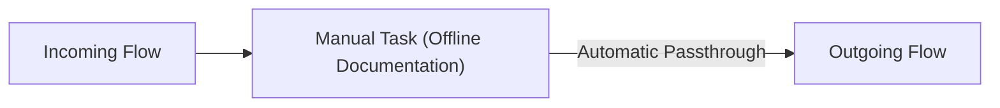

# Manual Task (`manual`)

## 1. Overview & Purpose
A **Manual Task** represents an offline, human activity performed entirely outside the purview of the BPM engine (e.g. filing physical paper folders in an archive cabinet, physically inspecting a vehicle at a garage).

## 2. Supported Scenarios
- **Documentation & Visual Modeling**: Included in the process diagram for complete business architecture documentation.
- **Runtime Passthrough**: Since the engine cannot track offline activity without a human completing a digital form, the engine immediately passes the execution token through to the next node.

## 3. Difference from User Task
- Use a **User Task** if an operator must click a button, fill out a digital form, or log into the application.
- Use a **Manual Task** only if the step is an offline reference marker.
