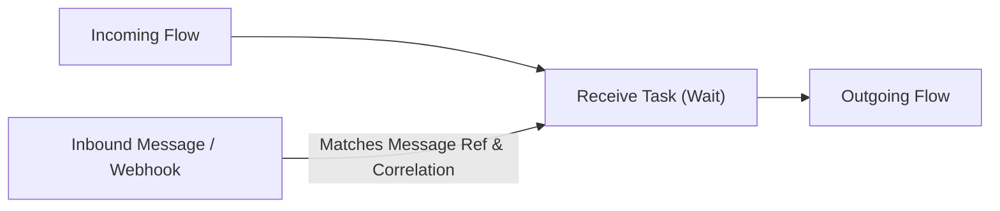

# Receive Task (`receive`)

## 1. Overview & Purpose
A **Receive Task** waits for an incoming enterprise message from an external system or queue. When execution reaches a Receive Task, the token suspends until a message with matching contract and correlation key is delivered, at which point the token resumes.

## 2. Supported Scenarios
- **Correlated Message Consumption**: Halts execution until a message arrives matching both `message` name and the instance's `correlationKey`.
- **WebService Implementation**: Standard BPMN web service interface mapping.

## 3. Properties
- `message`: Message asset identifier.
- `implementation`: `##WebService` or `Other`.
