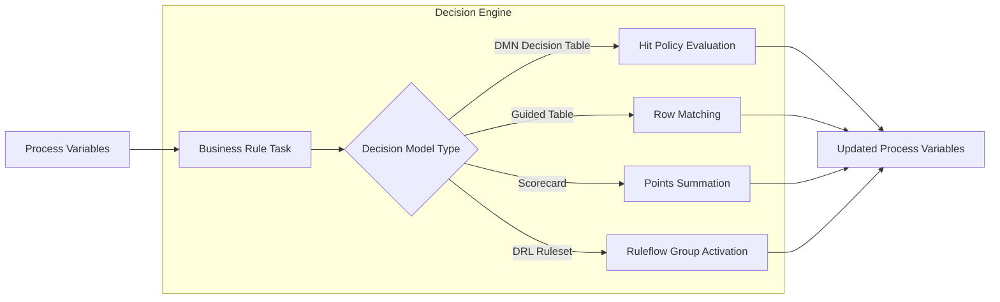

# Business Rule Task (`rule`)

## 1. Overview & Purpose
The **Business Rule Task** delegates business decision-making to declarative decision assets (DMN tables, Guided Decision Tables, Scorecards, Decision Trees, or Drools DRL rules). It evaluates inputs against structured business rules and sets output variables without requiring hardcoded procedural logic in code.



## 2. Supported Scenarios & Behavioral Variants

### Scenario A: DMN Standard Decision Table (`dmn.model`)
- **Behavior**: Evaluates an industry-standard DMN decision model. Supports all standard Hit Policies (`UNIQUE`, `FIRST`, `PRIORITY`, `COLLECT`). Evaluates input clauses and assigns output values to process variables.
- **When to Use**: Regulatory compliance, underwriting risk matrices, and shared decision tables designed by business analysts.

### Scenario B: Guided Decision Table (`guidedTable: 'table_name'`)
- **Behavior**: Evaluates a web-authored decision table directly from the project's Assets repository. Matches table condition columns against process variables and applies action values.
- **When to Use**: Business-user editable rule tables without XML/DMN complexity.

### Scenario C: Risk / Point-Based Scorecard (`scorecard: 'scorecard_name'`)
- **Behavior**: Calculates a weighted score by adding a baseline score to points earned across attribute bands (e.g. Credit Bureau Score + Age Range + Debt-to-Income Ratio). Collects reason codes.
- **When to Use**: Underwriting, credit approval, fraud risk assessment, and claims complexity scoring.

### Scenario D: Decision Tree (`decisionTree: 'tree_name'`)
- **Behavior**: Traverses a visual decision tree from the root node through matching branch conditions to a leaf node that applies outcome values.
- **When to Use**: Tiered classification logic and customer routing hierarchies.

### Scenario E: Drools Ruleflow Group (`ruleflowGroup: 'group_name'`)
- **Behavior**: Activates a named ruleflow-group in Drools DRL rulesets, firing rules against working memory.
- **When to Use**: Rule-flow group based execution, DRL rulesets, and Drools rule execution.

## 3. Property Reference & Possible Values

| Field | JSON Path | Type | Allowed Values | Default | Description |
|---|---|---|---|---|---|
| **Name** | `name` | `string` | Free text | `"Business Rule"` | Label. |
| **DMN Model** | `dmn.model` | `string` | Decision asset name | `undefined` | Name of the DMN decision asset. |
| **DMN Decision** | `dmn.decision` | `string` | Specific decision name | `undefined` | Target decision within the DMN model. |
| **Guided Table** | `guidedTable` | `string` | Guided table asset name | `undefined` | Target guided decision table asset. |
| **Scorecard** | `scorecard` | `string` | Scorecard asset name | `undefined` | Target scorecard asset. |
| **Decision Tree** | `decisionTree` | `string` | Decision tree asset name | `undefined` | Target decision tree asset. |
| **Ruleflow Group** | `ruleflowGroup` | `string` | Group name | `undefined` | Drools ruleflow-group to activate. |

## 4. When to Use & When NOT to Use
- **Do Use**:
  - Keep business policy separate from workflow structure (so underwriters can edit policy limits without redeploying the workflow).
  - Use Scorecards for risk-tiered decisions.
- **Do NOT Use**:
  - Do NOT use for basic variable incrementing (use Script Task).
  - Do NOT call external APIs inside rules (use Service Task).

## 5. Concrete Step-by-Step Examples

### Example 1: DMN Decision Table Evaluation
```json
{
  "id": "rule_evaluate_claim",
  "name": "Auto-Adjudication Decision",
  "type": "rule",
  "dmn": {
    "model": "claim_adjudication_rules",
    "decision": "DetermineClaimRoute"
  }
}
```

### Example 2: Financial Risk Scorecard
```json
{
  "id": "rule_scorecard",
  "name": "Calculate Underwriting Score",
  "type": "rule",
  "scorecard": "underwriter_risk_scorecard"
}
```

## 6. Testing Scenarios & Verification Guide
1. **Decision Matching**: Pass input variables; execute rule node; verify decision table action outputs are written to instance variables.
2. **Missing Asset Fault**: Point node to a non-existent decision model; verify engine produces `RULE_ERROR` catchable by Error Boundary.
3. **Scorecard Summation**: Verify baseline score + matching attribute points sum correctly into the scorecard target variable.
