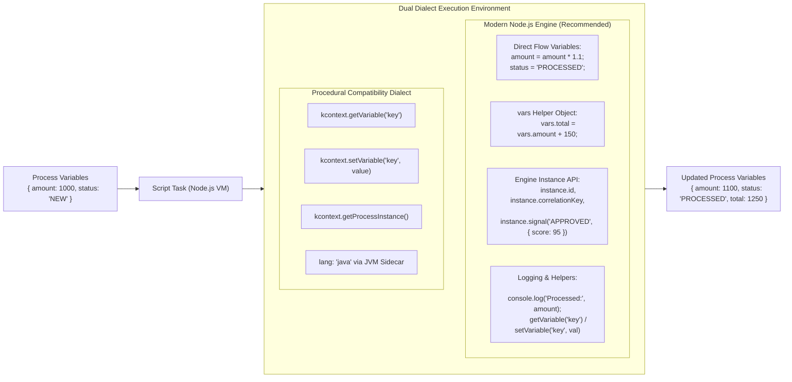

# Script Task (`script`)



---

## 1. Overview & Purpose

The **Script Task** executes procedural logic synchronously inside an isolated, secure execution realm. It is used to perform data transformations, calculate derived values, format payloads, or implement custom business rules directly in the workflow token flow.

Because this is a native **Node.js Workflow Engine**, authors have direct, idiomatic access to JavaScript and process variables without verbose ceremony. At the same time, the engine provides backward compatibility for procedural scripts using `kcontext` or Java 8 scripts.

> [!TIP]
> **Complete JavaScript & Variables Cheat Sheet**: For full syntax reference on sandbox globals (`vars`, bare variables, `instance` API, `node` metadata, `console.log`, sequence flow condition syntax, and cross-node data mapping), see the [JavaScript & Flow Variables Cheat Sheet](../../../../docs/usage_docs/15-javascript-and-flow-variables-cheatsheet.md). Also accessible directly from the Workflow Designer by clicking the **JS Cheat Sheet** button.

---

## 2. Modern Node.js Scripting vs Compatibility Dialect

| Capability | Modern Node.js / JavaScript (Recommended) | Procedural Compatibility Dialect |
|---|---|---|
| **Reading Variables** | Bare variable name: `amount` or `vars.amount` | `kcontext.getVariable("amount")` |
| **Writing Variables** | Bare assignment: `status = "APPROVED"` or `vars.status = "APPROVED"` | `kcontext.setVariable("status", "APPROVED")` |
| **Nested Objects & Arrays** | `vars.claim.items.push(newItem)` or `claim.total += 500` | Manual JSON serialization / deserialization |
| **Engine / Process Info** | `instance.id`, `instance.processName`, `instance.correlationKey` | `kcontext.getProcessInstance().getId()` |
| **Node Info** | `node.name`, `node.nodeId`, `node.id` | `kcontext.getNodeInstance().getNodeName()` |
| **Sending Signals** | `instance.signal("TYPE", payload)` or `instance.broadcast("TYPE")` | `kcontext.getKieRuntime().signalEvent("TYPE", payload)` |
| **Cancelling Instance** | `instance.abort()` | `kcontext.getKieRuntime().abortProcessInstance(id)` |
| **Logging & Debugging** | `console.log("Processing claim:", claimId)` | `System.out.println(...)` or loggers |
| **Language** | Native Node.js `node:vm` (`lang: 'js'`) | Java 8 Bytecode via Sidecar (`lang: 'java'`) |

---

## 3. Supported Scenarios & Behavioral Variants

### Scenario A: Modern Node.js Scripting (Recommended)
- **Behavior**: Runs natively in an isolated Node.js VM. All process variables are injected directly into scope as first-class JavaScript variables. Any bare assignment (`status = "REVIEW"`) or property assignment on `vars` (`vars.status = "REVIEW"`) is automatically synced back into the process instance upon script completion.
- **Exposed Engine Context**:
  - `vars`: Plain JavaScript record containing all in-scope process variables.
  - `instance`: Clean Node.js process instance object:
    - `instance.id`: String ID of current process instance.
    - `instance.processId`: Process definition key (e.g. `claim_workflow`).
    - `instance.processName`: Human-readable process name.
    - `instance.correlationKey`: Business correlation identifier (e.g. `POL-12345`).
    - `instance.state`: Current execution state (`'running'`, `'waiting'`, etc.).
    - `instance.signal(type, payload)`: Delivers a signal directly to this process instance.
    - `instance.signalOther(targetId, type, payload)`: Delivers a targeted signal to another process instance.
    - `instance.broadcast(type, payload)`: Broadcasts a signal tenant-wide.
    - `instance.abort()`: Aborts the current process instance immediately.
  - `node`: Metadata for current executing node (`node.id`, `node.nodeId`, `node.name`).
  - `getVariable(name)` / `setVariable(name, value)`: Top-level ergonomic helpers.
  - `console.log(...)`: Outputs log entries captured in process instance execution audit logs.
- **When to Use**: All new workflows, data transformations, array processing, and arithmetic calculations.

### Scenario B: Procedural kcontext Compatibility (`lang: 'js'`)
- **Behavior**: Provides the standard `kcontext` object hierarchy:
  - `kcontext.getVariable("key")`: Reads a process variable.
  - `kcontext.setVariable("key", value)`: Writes or updates a process variable.
  - `kcontext.getNodeInstance()`: Returns `{ getId(), getNodeId(), getNodeName() }`.
  - `kcontext.getProcessInstance()`: Returns `{ getId(), getProcessId(), getProcessName(), getCorrelationKey(), getState() }`.
  - `kcontext.getKieRuntime()`: Returns `{ signalEvent(type, event, [id]), abortProcessInstance(id) }`.
- **When to Use**: Running procedural scripts that require `kcontext` method syntax without modifying script contents.

### Scenario C: Real Java 8 Execution (`lang: 'java'`)
- **Behavior**: Dispatched to the local Java sidecar subprocess. The sidecar compiles and executes real Java 8 bytecode against typed variables (`java.lang.String`, `java.lang.Integer`, `java.util.Map`, etc.) with full standard library support (lambdas, streams, `Optional`).
- **When to Use**: Complex Java-specific calculations or legacy Java code.

---

## 4. Property Reference & Possible Values

| Field | JSON Path | Type | Allowed Values | Default | Description |
|---|---|---|---|---|---|
| **Name** | `name` | `string` | Free text | `"Script Task"` | Display name shown on canvas diagrams. |
| **Language** | `lang` | `string` | `'js'`, `'java'` | `'js'` | Execution sandbox dialect. Default `'js'` uses the native Node.js engine. |
| **Script Code** | `code` | `string` | Code string | `""` | The script statements executed inside the sandbox. |
| **Documentation** | `documentation` | `string` | Text notes | `""` | Authoring notes explaining the script's purpose and side effects. |

---

## 5. Concrete Step-by-Step Examples

### Example 1: Idiomatic Node.js Script (Recommended)
```json
{
  "id": "script_calculate_payout",
  "name": "Calculate Payout & Tier",
  "type": "script",
  "lang": "js",
  "code": "// 1. Access process variables directly as plain JS:\nconst base = claimAmount || 0;\nconst deductible = policyDeductible || 500;\n\n// 2. Compute results using standard JS math:\nconst netAmount = Math.max(0, base - deductible);\n\n// 3. Mutate variables directly or via vars helper:\nvars.payoutAmount = netAmount;\nvars.claimTier = netAmount > 10000 ? 'HIGH_EXPOSURE' : 'STANDARD';\nstatus = 'ADJUDICATED';\n\n// 4. Clean console logging:\nconsole.log(`Calculated net payout of $${netAmount} for claim ${instance.correlationKey}`);"
}
```

### Example 2: Compatibility Script
```json
{
  "id": "script_compat_variables",
  "name": "Compatibility Variable Mapping",
  "type": "script",
  "lang": "js",
  "code": "var amount = kcontext.getVariable(\"claimAmount\");\nvar deductible = kcontext.getVariable(\"policyDeductible\");\nvar net = amount - deductible;\nkcontext.setVariable(\"payoutAmount\", net);\nkcontext.setVariable(\"status\", \"ADJUDICATED\");"
}
```

### Example 3: Legacy Java 8 Sidecar Script
```json
{
  "id": "script_java_sidecar",
  "name": "Java String Formatter",
  "type": "script",
  "lang": "java",
  "code": "String id = (String) kcontext.getVariable(\"claimId\");\nString status = (String) kcontext.getVariable(\"status\");\nkcontext.setVariable(\"auditLine\", String.format(\"Case [%s] marked as %s\", id, status.toUpperCase()));"
}
```

---

## 6. Testing Scenarios & Verification Guide

1. **Direct Variable Mutation Test**:
   - Initial state: `{ claimAmount: 5000, policyDeductible: 500 }`.
   - Script: `payout = claimAmount - policyDeductible; status = 'APPROVED';`.
   - Verification: `instance.variables.payout === 4500` and `instance.variables.status === 'APPROVED'`.
2. **`vars` Object Mutation Test**:
   - Script: `vars.notes = ['Initial check passed']; vars.notes.push('Underwriting verified');`.
   - Verification: `instance.variables.notes` contains both entries.
3. **Instance Signal Test**:
   - Script: `instance.signal('REVIEW_PASSED', { score: 98 });`.
   - Verification: Matching event gateway or boundary signal catch fires.
4. **Timeout Enforcement Test**:
   - Script: `while(true) {}`.
   - Verification: Engine terminates script with `SCRIPT_ERROR: script timeout` after configured `scriptTimeoutSeconds`.

---

## 7. Operational Gotchas & Edge Cases

- **Variable Precedence**: Reserved sandbox identifiers (`vars`, `instance`, `node`, `env`, `console`, `kcontext`, `getVariable`, `setVariable`) cannot be overwritten by process variables with the same name.
- **Local vs Global Scope**: Inside a script, `const x = 1` or `let y = 2` are local scratch variables. To write a process variable, write bare `myVar = value` or `vars.myVar = value`.
- **Asynchronous Code**: Script tasks are strictly synchronous in the token path. Do not return unhandled Promises or make asynchronous HTTP calls; use **Service/HTTP Tasks** for outbound network requests.
