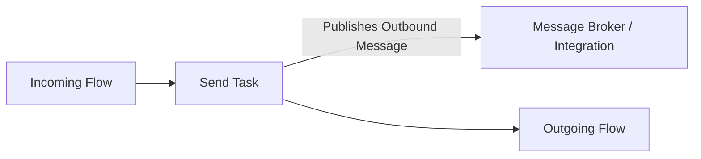

# Send Task (`send`)

## 1. Overview & Purpose
A **Send Task** dispatches an outbound message to an external system, integration service, or message broker. It emits the message payload asynchronously and immediately advances the execution token.

## 2. Supported Scenarios
- **Point-to-Point Correlated Message**: Dispatches a message directed to a specific waiting instance using `correlationKey`.
- **Broadcast Outbound Message**: Publishes a general event message.

## 3. Properties
- `message`: Target message asset contract.
- `correlationKey`: Correlation reference (`$claimId`).
- `implementation`: `##WebService` or `Other`.
