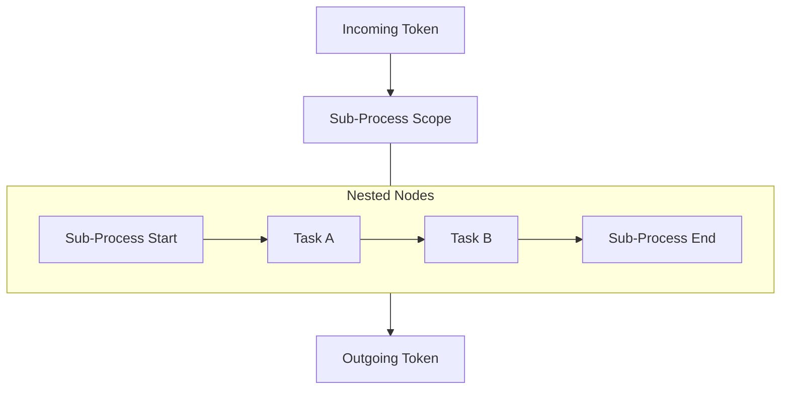

# Sub-Process (`subprocess`)

## 1. Overview & Purpose
A **Sub-Process** defines an internal visual and operational scope containing its own nested nodes and sequence flows. It allows process authors to organize complex diagrams into clean hierarchical containers, attach scoped boundary events across a group of nodes, or define event-driven handlers (Event Sub-Processes).

## 2. Supported Scenarios & Behavioral Variants

### Scenario A: Embedded Sub-Process
- **Behavior**: An inline visual container inside the main process. Execution enters through its incoming sequence flow, runs its nested nodes, and leaves via its outgoing sequence flow once its internal end node is reached. Shares the parent instance's variables directly.
- **When to Use**: Attaching a shared Boundary Timer or Error Boundary across multiple tasks (e.g. if any task inside the sub-process takes > 24 hours, abort all of them and escalate).

### Scenario B: Event Sub-Process (`on.error: string`)
- **Behavior**: Sits inside the process diagram without incoming or outgoing sequence flows (`triggeredByEvent: true`). It activates when an error is thrown anywhere in the parent process.
- **When to Use**: Global error recovery, compensation orchestrations, and incident alert pipelines.

### Scenario C: Transactional Sub-Process (`transaction: true`)
- **Behavior**: Commits changes atomically. If an internal activity aborts, any completed activities with attached Compensation Boundaries are automatically rolled back.
- **When to Use**: Multi-step booking or financial transfers.

## 3. Property Reference & Possible Values

| Field | JSON Path | Type | Allowed Values | Default | Description |
|---|---|---|---|---|---|
| **Name** | `name` | `string` | Free text | `"Sub-process"` | Display label. |
| **Transaction** | `transaction` | `boolean` | `true`, `false` | `false` | Enables transactional compensation on failure. |
| **Event Error** | `on.error` | `string` | Error code string | `undefined` | Triggers this container as an Event Sub-Process. |
| **Nodes** | `nodes` | `EngineNode[]` | Nested node definitions | `[]` | Internal activities within the sub-process. |
| **Flows** | `flows` | `EngineFlow[]` | Nested sequence flows | `[]` | Internal connections. |

## 4. When to Use & When NOT to Use
- **Do Use**:
  - To group 3–5 related activities together under a single shared Error Boundary.
  - For clean diagram organization in high-complexity enterprise processes.
- **Do NOT Use**:
  - If you need cross-project process reuse or independent versioning, use a **Call Activity** instead.
