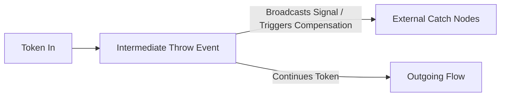

# Intermediate Throw Event (`throw`)

## 1. Overview & Purpose
An **Intermediate Throw Event** broadcasts an event into the execution environment or triggers transactional rollback compensation. When an execution token enters a Throw Event, it dispatches the configured event (Signal, Compensation, Message, or Escalation) and immediately continues down its outgoing sequence flow.



## 2. Supported Scenarios & Behavioral Variants

### Scenario A: Broadcast Signal Throw (`event: { signal: 'PolicyUpdated' }`)
- **Behavior**: Emits an untargeted broadcast signal across the tenant. Any active process instance currently waiting on an Intermediate Signal Catch or Signal Boundary with matching name receives the signal and resumes execution.
- **When to Use**: Event-driven choreography, inter-process communication, and status synchronization.

### Scenario B: Targeted / Correlated Signal Throw (`event.correlationKey: '$claimId'`)
- **Behavior**: Instead of broadcasting to all instances, narrows delivery strictly to the specific waiting instance whose own `correlationKey` matches the evaluated variable value.
- **When to Use**: Point-to-point inter-instance callbacks (e.g. child case notifying specific parent case).

### Scenario C: Compensation Throw (`event: { compensation: true }`)
- **Behavior**: Triggers compensation handlers (activities with attached Compensation Boundaries) in reverse completion order:
  - If `event.ref` is provided, compensates only that specific completed activity.
  - If `event.ref` is blank, compensates all completed activities in the current scope.
- **When to Use**: The Saga pattern; rolling back completed operations after a subsequent failure (e.g. reversing a reserved payment after warehouse allocation fails).

## 3. Property Reference & Possible Values

| Field | JSON Path | Type | Allowed Values | Default | Description |
|---|---|---|---|---|---|
| **Name** | `name` | `string` | Free text | `"Throw event"` | Display label. |
| **Throw Type** | `event.kind` | `string` | `'signal'`, `'message'`, `'escalation'`, `'compensation'` | `'signal'` | Event type to emit. |
| **Signal Name** | `event.signal` | `string` | Alphanumeric string | `undefined` | Broadcast signal identifier. |
| **Compensate Activity** | `event.ref` | `string` | Node ID | `undefined` | Specific node ID to compensate; blank = all completed. |
| **Correlate To** | `event.correlationKey` | `string` | `$varName` | `undefined` | Targeted correlation variable. |

## 4. When to Use & When NOT to Use
- **Do Use**:
  - Use Signal Throw to notify multiple asynchronous processes of a business milestone.
  - Use Compensate Throw to implement distributed undo/rollback mechanisms.
- **Do NOT Use**:
  - Do NOT use for external HTTP webhooks (use Service Task).
  - Do NOT confuse Signal Throw with Message Throw: Signals are broadcast by default; Messages are point-to-point.

## 5. Concrete Step-by-Step Examples

### Example 1: Broadcast Event Signal
```json
{
  "id": "throw_status_event",
  "name": "Emit Claim Approved Signal",
  "type": "throw",
  "event": {
    "signal": "ClaimApproved"
  }
}
```

### Example 2: Compensate Prior Booking Activity
```json
{
  "id": "throw_rollback",
  "name": "Compensate Policy Reservation",
  "type": "throw",
  "event": {
    "compensation": true,
    "ref": "http_reserve_policy"
  }
}
```

## 6. Testing Scenarios & Verification Guide
1. **Signal Broadcast**: Process A throws `Signal_X`; Process B has catch `Signal_X`; verify Process B token resumes.
2. **Targeted Delivery**: Throw signal with correlation key `$caseId = "101"`; verify only instance with correlation key `101` receives the signal.
3. **Compensation Execution**: Complete Task A (with compensation handler); throw compensation; verify compensation handler executes.
