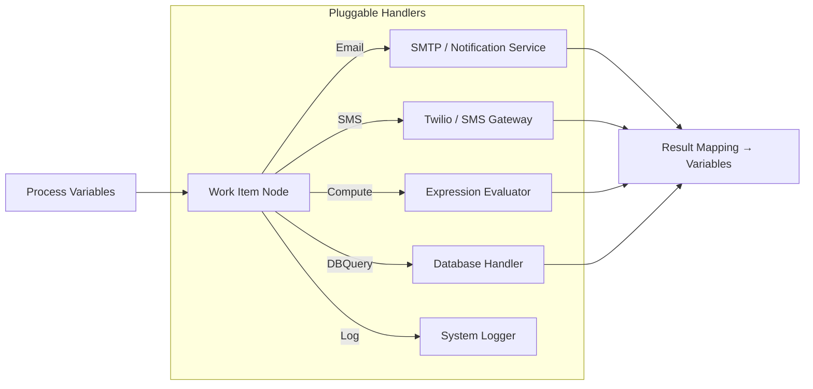

# Work Item Task (`workItem`)

## 1. Overview & Purpose
A **Work Item Task** integrates domain-specific pluggable handlers into the BPMN workflow. These pluggable handlers allow decoupling task execution from workflow orchestration. In our engine, built-in handlers include **Email**, **SMS**, **DBQuery**, **Compute**, and **Log**, with full parameter substitution and result binding.

## 2. Supported Scenarios & Behavioral Variants

### Scenario A: Email Task (`handler: 'Email'`)
- **Behavior**: Dispatches an email using the configured SMTP settings (from System Settings or environment variables). If email delivery is disabled, it simulates delivery safely in local/dev environments.
- **Parameters**: `to`, `subject`, `body`, `from`.
- **When to Use**: Customer status notifications, claims receipts, and employee alerts.

### Scenario B: SMS Task (`handler: 'SMS'`)
- **Behavior**: Sends an SMS text message to a recipient mobile phone number via an external SMS provider.
- **Parameters**: `to`, `text`.
- **When to Use**: Time-sensitive OTPs, appointment reminders, and urgent approval requests.

### Scenario C: Compute Task (`handler: 'Compute'`)
- **Behavior**: Evaluates a mathematical or logical expression over input parameters and maps the resulting calculation directly into a process variable.
- **Parameters**: `expression` (e.g. `p1 * (1 + p2/100)`).
- **When to Use**: Formula evaluations, premium calculations, and metric scoring.

### Scenario D: Log Task (`handler: 'Log'`)
- **Behavior**: Outputs structured audit logging information to the engine log.
- **Parameters**: `message`.
- **When to Use**: Debugging, process milestone tracking, and compliance trails.

## 3. Property Reference & Possible Values

| Field | JSON Path | Type | Allowed Values | Default | Description |
|---|---|---|---|---|---|
| **Name** | `name` | `string` | Free text | `"Send email"` | Label. |
| **Handler** | `handler` | `string` | `'Email'`, `'SMS'`, `'DBQuery'`, `'Compute'`, `'Log'` | `'Email'` | Work item handler name. |
| **Parameters** | `params` | `Record<string, unknown>` | `$varName` or literal | `{}` | Parameter inputs to handler. |
| **Result Mapping** | `resultTo` | `Record<string, string>` | `varName ← resultKey` | `{}` | Output result mapping. |

## 4. When to Use & When NOT to Use
- **Do Use**:
  - Out-of-the-box communication tasks (Email, SMS) where full REST API configuration isn't needed.
  - Compute tasks for clean mathematical formulas without writing script blocks.
- **Do NOT Use**:
  - Do NOT use for custom microservice REST calls with custom headers and bodies (use **Service Task**).
